# OpenRCCars

Open-source'owa reimplementacja **RC Cars** (Creat Studio, 2002) na silniku
[Tempest](https://github.com/Try/Tempest), tym samym, na którym działa OpenGothic.

Projekt nie zawiera żadnych danych gry. Wczytuje assety z legalnie kupionej instalacji
(Steam/GOG): `RCCars.pack`, `RCCarsDB/*.sb` i pliki obok `RCCars.exe` (`Language/`, `Tracks/`).

Zachowanie gry przenosimy z kodu oryginału: `RCCars.exe` jest zaszyfrowany zabezpieczeniem Steam, odszyfrowaliśmy
go tylko do analizy. Adresy funkcji (np. 0x4f5e50) w kodzie i w dokumentacji odnoszą się do tego pliku.

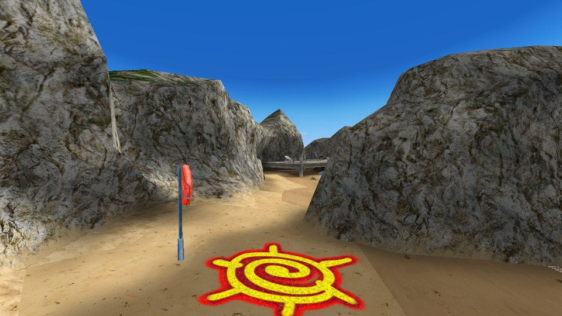

- [Co już działa](#co-już-działa)
- [Budowanie](#budowanie)
- [Uruchamianie](#uruchamianie)
- [Sterowanie](#sterowanie)
- [Tryb deweloperski](#tryb-deweloperski)
- [Narzędzia](#narzędzia)
- [Struktura kodu](#struktura-kodu)
- [Dokumentacja](#dokumentacja)
- [Czego jeszcze brakuje](#czego-jeszcze-brakuje)

## Co już działa

Szczegóły każdego punktu, z adresami w `RCCars.exe`, są w [docs/rccars_exe.md](docs/rccars_exe.md), a formaty
plików w [docs/formaty.md](docs/formaty.md).

- **Dane gry**: archiwum `RCCars.pack` (deszyfrowanie), tekstury `.csi` (wszystkie 1316 z archiwum), sceny `.sb`
  (wszystkie 18: siatki, lightmapy, markery, kolizje `COLL`, instancje obiektów), ustawienia `Settings/*.ini`,
  krzywe `.bspl`/`.spl`, nagrania przeciwników, teksty `Language/*/*.tbl`.
- **Grafika**: 10 tras z teksturami, lightmapami, mieszaniem tekstur terenu, alpha-testem i przezroczystością; mgła
  każdej trasy jak w oryginale (`Settings/fog_<trasa>.ini`); morze z falami, pianą przy brzegu i odbiciami mapy
  otoczenia; płaskie strumienie i kałuże.
- **Auto**: Overkill, Buggy i Hummer z `Car.sb` na starcie gracza (`INST 'Player'`), z kołami i zawieszeniem
  rysowanymi jak w oryginale, ulepszeniami na modelu, modelami LOD dalej od kamery, odbiciami na karoserii i
  szybach, cieniem pod autem gracza i przyciemnianiem w cieniu i w tunelach według lightmapy. Antena gracza i
  przeciwników sprężynuje jak w `RCCars.exe` (`Antenna_Car<n>.ini`): gnie się przy ruszaniu, hamowaniu i skrętach,
  a pod niskim sufitem kładzie się do tyłu.
- **Świat**: słońce na znaczniku `SUN_AF` z flarą obiektywu (`LENS_FLARE.ini`), tekstury detali z bliska
  (`Detail.ini`), wynurzająca się łódź podwodna i obracający się radar na beach_4 (`submarine.ini`), dym z chłodnic
  (`hatch_smoke.ini`).
- **Kamera za autem** z `Settings/Camera.ini` (odległość, opóźnienia, odsuwanie przy prędkości i turbo, unoszenie,
  gdy teren zasłania auto), która nie schodzi pod wodę.
- **Fizyka jazdy jak w `RCCars.exe`**: własny model auta oryginału (bryła 1 kg, kule nadwozia z `cdt<N>.ini`, koła
  jako kule na sprężynach, opony z poślizgiem, silnik z krzywej auta, dopalacz i turbo, skręt, skok, opory, głęboki
  piasek i woda) z jego własnym ruchem i zderzeniami z trasą, autami, rekwizytami i postaciami.
  [Bullet](https://github.com/bulletphysics/bullet3) porusza tylko rekwizyty.
- **Nawierzchnie i woda**: rodzaj nawierzchni z bitów materiału tekstury; jazdę zmieniają tylko głęboki piasek i
  woda, reszta różni się kurzem i śladami. W głębokiej wodzie auto tonie i wraca na ostatni punkt kontrolny; tak
  samo po R, po wyjechaniu poza pudło kolizji trasy i w strefach `car_reset_volume_*` („Słaby sygnał”).
- **Wyścig**: odliczanie z dźwiękami startu, 3, 5 albo 7 okrążeń, punkty kontrolne `cp_N` zaliczane jak w
  oryginale, korytarz trasy, „zły kierunek”, czasy okrążeń, ekran mety jak w oryginale (`dlgFINISH`: twarze,
  czasy, różnice, najlepsze okrążenia, średnie prędkości, „Wyjdź” i „Jeszcze raz?”).
- **Kokpit** z obrazków i czcionek gry (`Language/Polish` albo `Language/English`) w miejscach z
  `Settings/cockpit.ini`: metaliczne cyfry `cock_num`, zegary dopalacza i prędkości, mapa trasy, miejsce w wyścigu,
  strzałka kierunku 3D z `cockpit.sb`, animowane strzałki nad następnym punktem, „Łup!”/„Wielkie Łup!” i konsola
  czatu z komunikatami wyścigu.
- **Przeciwnicy**: odtwarzają nagrane przejazdy (`CarProfiles`) w tempie oryginału z „gumką”, w składzie z
  `Scripts/ailayouts.ini`; potrąceni wypadają z nagrania, jadą z fizyką i autopilot z gry prowadzi ich z powrotem.
- **Rekwizyty** ze `stone.sb` (puszki, butelki, piłki, pachołki, kłębki toczone wiatrem …) jako bryły sztywne z
  parametrami ze skryptów modeli, z dźwiękami uderzeń.
- **Ludzie i zwierzęta** (`people.sb`, `AIChars.sb`): plażowicze, którzy kopią i rzucają autem i zostawiają ślady
  stóp, strażnicy, którzy strzelają, mewy, kraby, pająki, psy i sępy.
- **Ruch uliczny** (`Roadcar.sb`): hummery, kampery, pikapy i strzelający BTR na nagranych ścieżkach, ze światłami,
  klaksonem, plamami reflektorów i cieniami kół.
- **Efekty**: kurz spod kół (też przy buksowaniu), bryzgi wody, ślady opon, kilwater i piana, spaliny dopalacza,
  brudzenie i zmywanie karoserii, rozbryzgi fal o skały, fale przy brzegu, serie strzałów z trafieniami.
- **Dźwięk** według `RCCars.exe` we własnym mikserze: kanały `SNCH` z `RCCars.sb` i `Sound\*.wav`, silnik gracza i
  przeciwników, punkty kontrolne, turbo, hamulec, lot i lądowanie, nawierzchnie, uderzenia, buksowanie, woda, szum
  morza, wodospady, głosy ludzi, mew i psów, ruch uliczny i muzyka MP3 z `Tracks/` w kolejności z `Autoexec.gm`.
- **Menu**: menu główne z panelem gracza, szybki wyścig (trasa, auto, okrążenia, przeciwnicy), wybór gracza
  (zakładanie, usuwanie, zdjęcie, sortowanie), „Mapa i informacje” (mapa trasy, zdjęcia, opis) i „Statystyki toru”
  (wyniki wszystkich graczy), „Opcje” (wideo, kokpit, dźwięk, urządzenia, klawisze, zaawansowane, wiadomości,
  zapisywane w `RCCars.crs`), „Twórcy”, ekran wczytywania i menu Esc w wyścigu, z obrazkami, czcionkami i dźwiękami
  oryginału.
- **Mistrzostwa** z `Scripts/championship.ini`: tabela tras (otwierane wynikami), opłata przed wyścigiem
  z przeciwnikami „Ekspert”, trening, nagrody i premia za uderzenia i przewagę na ekranie mety, nowe mistrzostwa,
  gratulacje po ostatniej trasie; garaż z kupowaniem i sprzedażą aut, skórkami i ulepszeniami dopalacza, silnika
  i kół, które zmieniają wygląd i jazdę auta.
- **Wyścig duchów**: „Zwykły” (z duchem najlepszego okrążenia tego wyścigu) i „Multi” (duchy wszystkich trzech aut
  z plików `GhostRecords/track<n>/Track<n>_Car<m>.scg` oryginału, zapisywane po wyścigu).
- **Dwóch graczy** na podzielonym ekranie („Wielu graczy” → „Dwóch graczy”): wyścig na okrążenia albo na przewagę
  („Opóźnienia”), dowolne auta i ulepszenia, osobne zegary, mapa i pasek postępu jak w oryginale, drugi gracz na
  klawiszach Klaw.2 (Tab, W A S D, Alt, Z, C) albo własnych z opcji.
- **Gracze**: pliki `Players/*.scp` oryginału (czytane i zapisywane bajt w bajt), wybrany gracz w `RCCars.crs`;
  po wyścigu zapisują się najlepsze okrążenie i wyścig, czas gry, liczba wyścigów i przejechane metry.
- **Narzędzia**: `rcinfo` (inspekcja i eksport danych, testy bez GPU) i `rcshot` (render offscreen do PNG).

<details>
<summary>Zrzuty ekranu</summary>

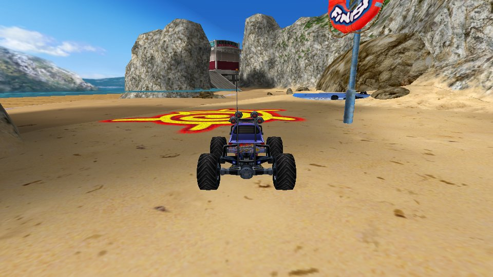


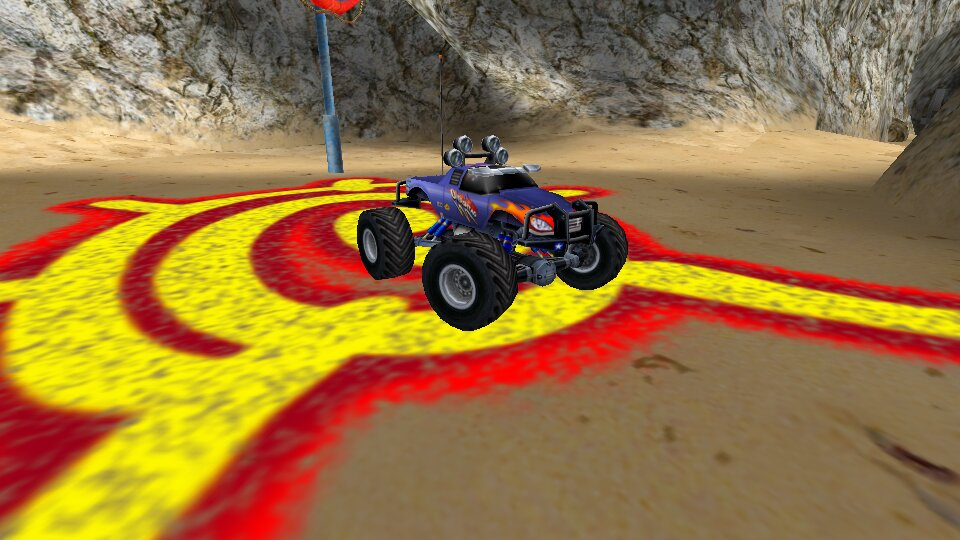

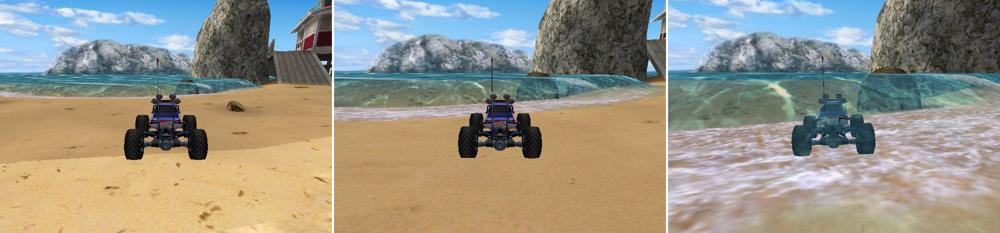

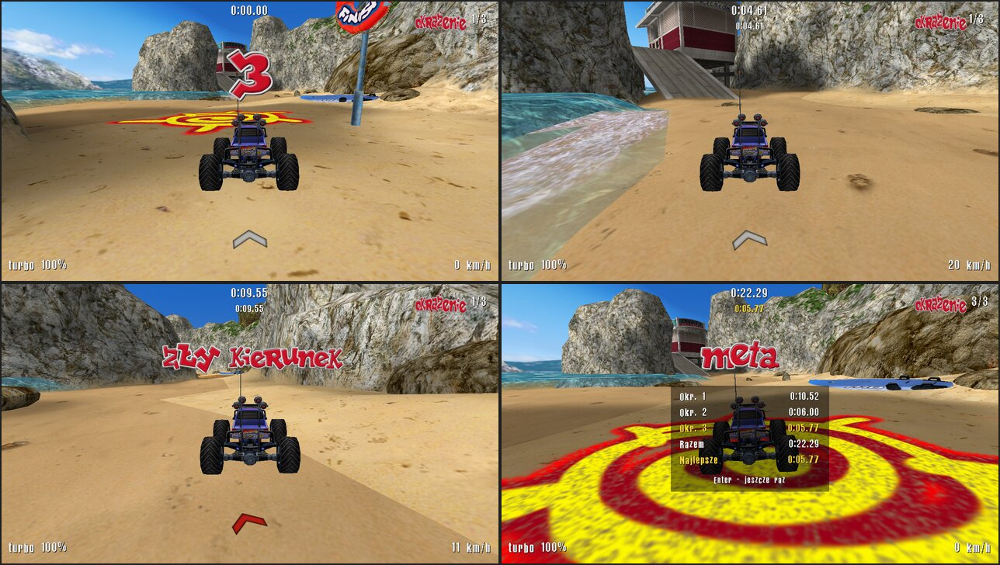

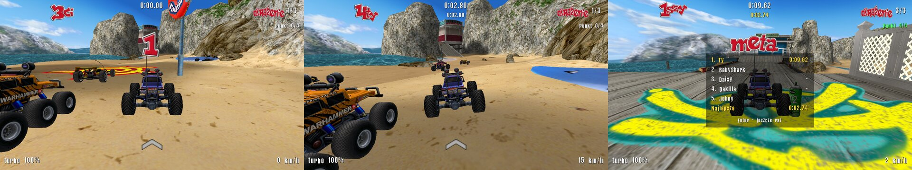

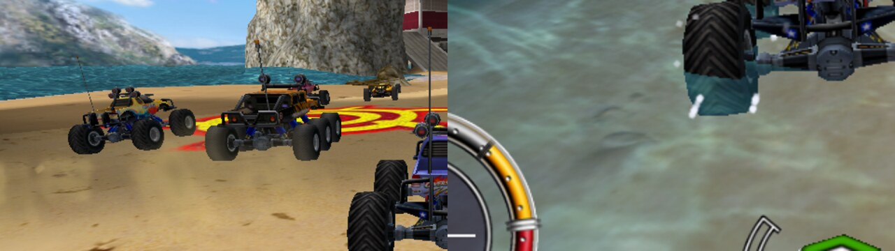

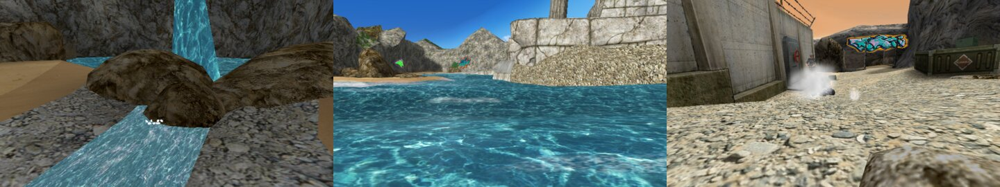

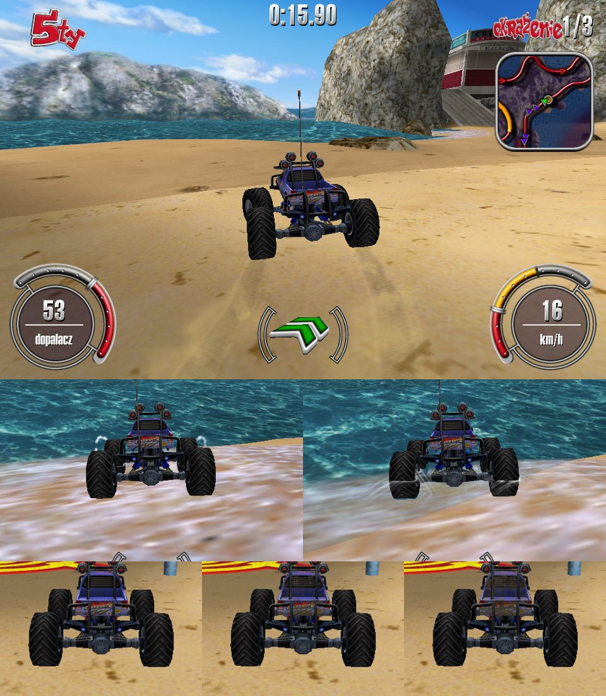

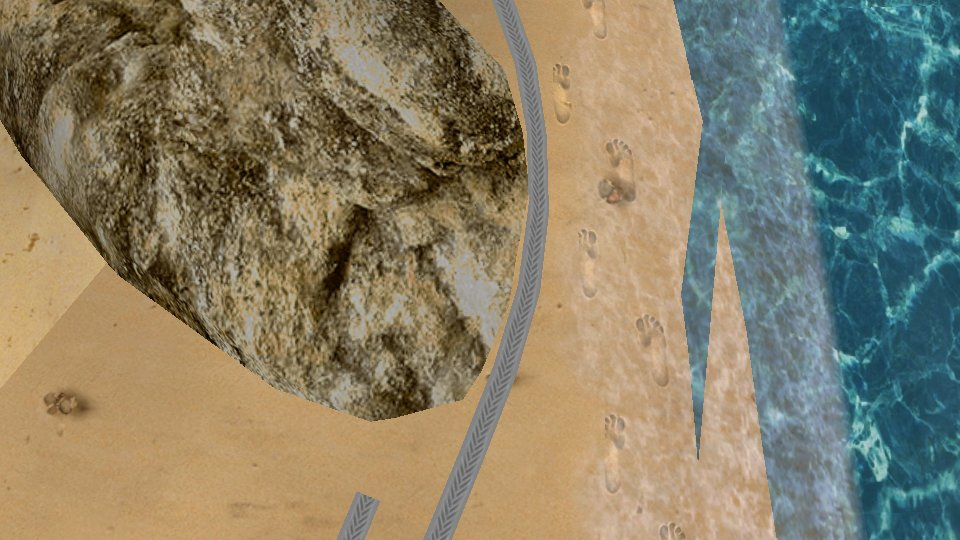


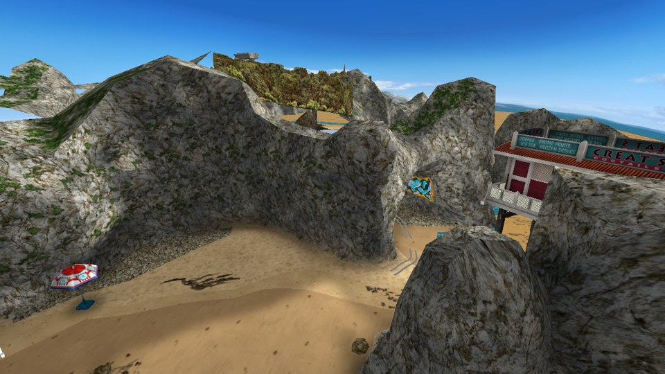

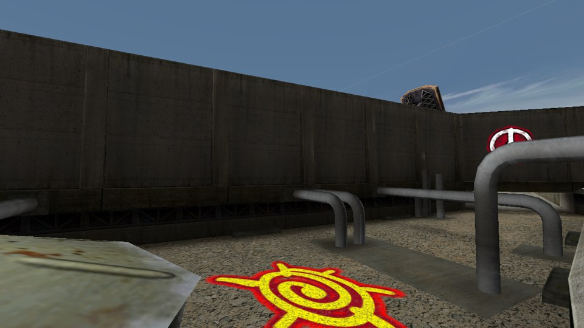

</details>

## Budowanie

### Windows

Wymagania:
- Visual Studio 2022 z obciążeniem *Programowanie aplikacji klasycznych w C++* (zawiera CMake)
- [Vulkan SDK](https://vulkan.lunarg.com/sdk/home) **1.4.357 lub nowszy** (Tempest używa nowych rozszerzeń; instalator
  ustawia zmienną `VULKAN_SDK`)
- Git (CMake przy pierwszej konfiguracji sam pobiera [Bullet](https://github.com/bulletphysics/bullet3) 3.25)

```bat
git clone --recursive https://github.com/maxis27/OpenRCCars.git
cd OpenRCCars
:: jeśli sklonowano bez --recursive albo rozpakowano z archiwum:
git submodule update --init --recursive

cmake -B build -G "Visual Studio 17 2022" -A x64
cmake --build build --config RelWithDebInfo
```

### Linux

```sh
sudo apt install build-essential cmake ninja-build libx11-dev libxcursor-dev glslang-tools libvulkan-dev
cmake -B build -G Ninja -DCMAKE_BUILD_TYPE=RelWithDebInfo
cmake --build build
```

Jeśli systemowe nagłówki Vulkana są starsze niż 1.4.357, ustaw `VULKAN_SDK` na katalog z aktualnymi
[Vulkan-Headers](https://github.com/KhronosGroup/Vulkan-Headers) (podkatalog `include`).

### Same narzędzia

Narzędzia do danych bez Tempesta i GPU: `cmake -B build -DOPENRCCARS_TOOLS_ONLY=ON`.

CI (`.github/workflows/ci.yml`) buduje narzędzia i całą grę na Linuksie i Windows i udostępnia gotowe pliki jako
artefakty `OpenRCCars-windows` i `OpenRCCars-linux`.

## Uruchamianie

```bat
build\bin\RelWithDebInfo\OpenRCCars.exe -g "D:\SteamLibrary\steamapps\common\RCCars"
```

```sh
./build/bin/OpenRCCars -g ~/.steam/steam/steamapps/common/RCCars
```

Gra startuje w menu głównym jak oryginał. Opcje:

| Opcja | Działanie |
|---|---|
| `-g <folder gry>` | instalacja RC Cars (domyślnie bieżący katalog) |
| `-l <trasa>` | od razu wyścig na tej trasie, bez menu (np. `-l beach_1`) |
| `-dev` | tryb deweloperski jak `RCCars.exe -dev`, z naszymi klawiszami debugowania ([niżej](#tryb-deweloperski)) |
| `-dx12` | backend DirectX 12 (eksperymentalnie) |
| `-validation` | warstwy walidacji Vulkana |

Okno albo pełny ekran wybiera ustawienie oryginału „Uruchom w oknie” z `RCCars.crs` w folderze gry
(`[Video] VIDEO_RunInWindow`, w grze „Opcje wideo” → „Uruchom w oknie”, od następnego startu): w oknie gra ma 800x600 jak menu oryginału, bez tego ustawienia (domyślnie) pełny
ekran. Pełny ekran nie zmienia rozdzielczości monitora, choć oryginał przełącza go na 800x600.

## Sterowanie

Klawisze auta ustawia się w „Opcje” → „Dostosuj sterowanie” (zapisane w `RCCars.crs` jak w oryginale). Domyślny
układ „Klaw.1”:

| Klawisz | Akcja |
|---|---|
| ↑ | gaz |
| ↓ | hamulec, po zatrzymaniu wsteczny |
| ← , → | skręt w lewo / w prawo |
| Spacja | skok (przewrócone auto: na koła) |
| Shift | dopalacz (zużywa turbo, ok. 10 s z pełnego zbiornika) |
| B | zablokuj koła (tylne, do poślizgu) |
| R | powrót do ostatniego głównego punktu kontrolnego (przed pierwszym: na start); w wyścigu duchów na start |

Układ „Klaw.2” to W / S / A / D, Tab (dopalacz), Alt (skok), Z (hamulec), C (powrót); to domyślne klawisze
drugiego gracza na podzielonym ekranie.

| Klawisz | Akcja |
|---|---|
| Enter | wyścig od nowa, od odliczania („Jeszcze raz”); na ekranie mety „Wyjdź”, jak Esc |
| P, Pause | pauza |
| Esc | menu wyścigu: Przerwij (do menu głównego, z wyścigu duchów na jego ekran), Wróć na tor (w wyścigu duchów Wróć na start), Zastosuj (dalej), Jeszcze raz? |
| F12 | licznik FPS (nasz klawisz; jak w oryginale włącza go też `Set ShowFPS 1` w `Config.gm` albo `Autoexec.gm`) |

Menu obsługuje się myszą. W menu głównym trasę wybiera się obrazkami (też ← / →); „Szybki wyścig” to tor, liczba
okrążeń, umiejętności przeciwników i auto; zielony „Wyścig” rusza (też Enter), „Wyjdź” pyta, czy zamknąć grę. W „Zmień gracza”
lista graczy (też ↑ / ↓, kółko myszy), „Utwórz gracza” pyta o imię, „Zdjęcie” pozwala zmieniać zdjęcie strzałkami
obok niego, „Kontynuuj” (też Enter, Esc) wybiera zaznaczonego gracza. W „Mistrzostwach” trasę wybiera się w tabeli
(też ↑ / ↓), „Wyścig” pokazuje opłatę i przeciwników, „Garaż” to auta (strzałki, kupno, sprzedaż, skórka)
i ulepszenia (strzałki pod obrazkiem wybierają poziom). „Wyścig duchów” to tor, auto i typ wyścigu („Zwykły”,
„Multi”). „Mapa i informacje” (zdjęcia strzałkami albo ← / →, trasa strzałkami albo ↑ / ↓) i „Statystyki toru”
(rodzaj wyniku strzałkami albo ← / →, lista ↑ / ↓ i kółkiem) to strony szybkiego wyścigu, wyścigu duchów
i mistrzostw. Szybki wyścig i wyścig duchów ruszają tylko kupionym autem na otwartej trasie. W „Opcjach” wartości
zmienia się strzałkami (też ← / → dla wskazanego wiersza) i suwakami; klawisz akcji zmienia się kliknięciem pola
i naciśnięciem klawisza (Delete czyści, Esc rezygnuje). „Demo gry” (albo 3 minuty w menu głównym bez klikania)
pokazuje nagrane wyścigi na Surferach, Rybakach i Silosie po kolei: Enter przechodzi do następnego, Esc wraca do
menu. Przycisk gry wielu graczy, której jeszcze nie ma, jest szary.

Na starcie gra pokazuje intro z `Tracks/Intro.dat` (logo 1C, logo Creat Studio i film; Esc przeskakuje bieżącą
część), potem ekran startowy z logami podczas wczytywania. Intro wyłącza `Set "AutoRunIntro" 0` w `Config.gm`;
nie gra też w trybie deweloperskim ani z `-l`.

Oryginał pokazuje menu zawsze w 800x600 (`RCCars.exe` 0x4a6840). U nas menu wypełnia całe okno: tło jest rozciągnięte
na szerokość (w oknie węższym niż 4:3 na wysokość), przyciski po prawej trzymają się krawędzi i łuków tła, a obrazki,
napisy i auto zachowują proporcje.

## Tryb deweloperski

`-dev` działa jak w `RCCars.exe -dev`: lot autem (F9), szybkie wyjście (F11) i wpisywane kody oryginału. Nasze
klawisze debugowania (G, N, T i przełączniki tras, aut i przeciwników) działają tylko w tym trybie. Jak tryb
działa w oryginale, opisuje [docs/rccars_exe.md](docs/rccars_exe.md#tryb-deweloperski).

| Klawisz | Akcja |
|---|---|
| F9 | lot autem jak w oryginale: auto bez fizyki, kamera sztywno za nim, bez powrotu na punkt kontrolny; drugi raz: auto znowu jedzie z miejsca, w którym jest |
| ↑ / ↓, W / S | (lot) do przodu / do tyłu, `ZeroSpeed` m/s (15 z `Autoexec.gm`) |
| ← / → | (lot) obrót, `ZeroAngle` stopni/s (90) |
| Alt + ↑ / ↓, Alt + ← / → | (lot) w górę / w dół, w bok |
| A / Z | (lot) nos w górę / w dół |
| End | (lot) wypoziomuj |
| Shift | (lot) dwa razy szybciej |
| F11 | natychmiastowe wyjście (oryginał: `WM_CLOSE`) |
| F1–F10 | trasy: beach_1–4, country_1–4, urban_1–2 (urban_1 to Shift+F9) |
| 1 / 2 / 3 | auto: Overkill / Buggy / Hummer |
| U | następny poziom ulepszeń (0–3: dopalacze, rezonatory, opony razem) |
| L | liczba okrążeń: 3 / 5 / 7 (i wyścig od nowa) |
| O | przeciwnicy: brak / łatwy / normalny / trudny (i wyścig od nowa) |
| G / kod `stat` | kule zaliczania punktów kontrolnych (1,6 m) |
| N | przeskok do następnego głównego punktu kontrolnego (do sprawdzania okrążeń i mety) |
| T | postaw auto na koła w miejscu |

Kody wpisuje się w czasie gry (litery i cyfry po kolei, najwyżej 2 s między nimi, wielkość liter bez znaczenia;
zły klawisz zaczyna kod od nowa). Klawisz, który kontynuuje rozpoczęty kod, nie trafia do naszych skrótów (`E1` nie
przełącza auta, `constr` nie zmienia przeciwników). Gdy otwarte jest menu, kody nie działają.

| Kod | Działanie |
|---|---|
| `dt0`–`dt5` / `dtx` | brud auta na stałym poziomie / znowu normalnie |
| `constr` | nakładka kolizji: zielone podłoże, żółte zbocza, czerwone ściany, niebieskie niewidoczne ściany, turkusowa woda, fioletowy głęboki piasek |
| `E1` | kamera „ZERO”: lata klawiszami jak auto przy F9, gra toczy się dalej, auto stoi bez kierowcy |
| `E2` | kamera stoi w miejscu |
| `C1` | z powrotem kamera wyścigowa |
| `I` | własna kamera „ZERO” i gra zatrzymana; drugi raz: powrót i gra rusza |
| `F` | przy zatrzymanej grze (`I`) jedna klatka gry (`FixedTime` ms albo czas ostatniej klatki); inaczej jak `I` |
| `stat` | kule zaliczania punktów kontrolnych, jak G |

Kule zaliczania (G) to jedyny dodatek spoza oryginału na ekranie: następna główna zielona, kolejna żółta, zaliczone
w tym okrążeniu szare, zaliczona przed chwilą miga na zielono, pośrednia, na którą wskazuje strzałka, niebieska.
Każde zaliczenie trafia też do logu.

## Narzędzia

```sh
rcinfo <folder_gry> pack                          # statystyki archiwum
rcinfo <folder_gry> check                         # dekoduje wszystkie tekstury i sceny (test regresji)
rcinfo <folder_gry> sb RCCarsDB/beach_1.sb        # statystyki sceny, tekstury, markery
rcinfo <folder_gry> nodes RCCarsDB/Roadcar.sb Btr # drzewo węzłów modelu: położenie, osie, wierzchołki, tekstury
rcinfo <folder_gry> obj RCCarsDB/Car.sb car.obj   # eksport geometrii do OBJ
rcinfo <folder_gry> coll RCCarsDB/beach_1.sb [coll.obj]  # siatka kolizji: statystyki, test raycastu, eksport OBJ
rcinfo <folder_gry> extract "Scripts\upgrades.ini" upgrades.ini
rcinfo <folder_gry> csi "Textures.1\ang_dor.csi" ang_dor.tga
rcinfo <folder_gry> drive RCCarsDB/beach_1.sb [auto 1-3] [ulepszenie 0-3]  # jazda testowa bez GPU (autopilot po punktach, z rekwizytami)
rcinfo <folder_gry> objects RCCarsDB/beach_1.sb   # obiekty na trasie (INST): model, rodzaj, fizyka; test opadania rekwizytów
rcinfo <folder_gry> race RCCarsDB/beach_1.sb [okrążenia]  # punkty kontrolne i test logiki wyścigu (bez fizyki)
rcinfo <folder_gry> scp Players/Gracz.scp         # profil gracza: rekordy, auta, test zapisu bajt w bajt
rcinfo <folder_gry> crs                           # wybrany gracz w RCCars.crs, test zapisu
rcinfo <folder_gry> gates RCCarsDB/beach_1.sb [auto 1-3]  # każdy główny punkt kontrolny zaliczony autem z fizyką
rcinfo <folder_gry> ai RCCarsDB/beach_1.sb [poziom 1-3] [okrążenia]  # przeciwnicy: nagrania, ich pętle i wyścig bez gracza
rcinfo <folder_gry> ram RCCarsDB/beach_1.sb [przeciwnik] [s] [side]  # gracz wjeżdża w przeciwnika: wypadnięcie z nagrania, powrót, „Łup!”
rcinfo <folder_gry> drown RCCarsDB/beach_1.sb [auto 1-3]  # strefy powrotu, pudło kolizji, czas tonięcia na kilku głębokościach (też przeciwnika)
rcinfo <folder_gry> fx                            # ustawienia efektów, ile cząsteczek, śladów i kilwatera daje auto na każdej nawierzchni
rcinfo <folder_gry> shade RCCarsDB/beach_2.sb     # lightmapa wzdłuż trasy i jasność aut, jaką daje
rcinfo <folder_gry> fog beach_1                   # mgła trasy: gęstość, kolor, ile koloru zostaje w danej odległości
rcinfo <folder_gry> traffic beach_2 [s]           # ruch uliczny: odjazdy, wysokość kół nad drogą, światła, cienie, potrącenie gracza
rcinfo <folder_gry> shots beach_4 [auto 1-3] [s]  # strażnicy i BTR strzelają do auta: serie, trafienia, odrzut, powrót
```

`rcshot` renderuje trasę offscreen do PNG, z autem i kamerą za nim. Zmienne środowiskowe ustawiają scenę:

```sh
rcshot <folder_gry> beach_1 shot.png [w h] [x y z yaw pitch]
RCSHOT_CAR=Car3 rcshot ...                                      # inne auto (Car1/Car2/Car3), none = sama trasa
RCSHOT_NOSUN=1 rcshot ...                                       # bez słońca i flary
RCSHOT_ANTENNA=0 rcshot ...                                     # antena jak w modelu, bez symulacji
RCSHOT_COLL=1 rcshot ...                                        # z nakładką kolizji
RCSHOT_DRIVE=3 RCSHOT_STEER=1 rcshot ...                        # najpierw 3 s jazdy na pełnym gazie, druga połowa ze skrętem
RCSHOT_DRIVE=2 RCSHOT_JUMP=1.6 rcshot ...                       # skok w 1,6 s, zdjęcie w 2 s
RCSHOT_DRIVE=3 RCSHOT_BOOST=1 rcshot ...                        # z dopalaczem
RCSHOT_DRIVE=1 RCSHOT_JUMP=0.8 RCSHOT_VIEW=90,0.6 rcshot ...   # z bliska, z lewego boku auta (0 = z tyłu), z 0,6 m
RCSHOT_START="-8 -41 90" RCSHOT_DRIVE=1.6 rcshot ...            # auto najpierw w punkcie x z, obrócone o yaw (tu: do morza)
RCSHOT_START="69.6 -6.4 0 4.5" RCSHOT_VIEW=270,0.6,0.4 rcshot <gra> beach_2 ...  # na ziemi pod y = 4,5 (w tunelu), kamera z prawej, wyżej
RCSHOT_NOSHADOW=1 rcshot ...  /  RCSHOT_SHADE=1 rcshot ...      # bez cienia pod autem / jasność auta 1 zamiast lightmapy
RCSHOT_TIME=2.5 rcshot ...                                       # chwila animacji wody (fale, piana)
RCSHOT_OBJECTS=0 rcshot ...                                      # bez rekwizytów
RCSHOT_FOG=0 rcshot ...                                          # bez mgły
RCSHOT_FX=2 rcshot ...                                           # najpierw 2 s efektów trasy (rozbryzgi, fale, strzały)
RCSHOT_ACTOR=Guard RCSHOT_ACTOR_CAR=4 RCSHOT_FX=1 rcshot <gra> beach_4 ...  # strażnik strzela do auta
RCSHOT_ACTOR=Man RCSHOT_ACTOR_CAR=8 RCSHOT_FX=42 rcshot <gra> beach_1 out.png 960 540 -12 1.6 -95.2 -90 -80  # ślady stóp
RCSHOT_TRAFFIC=20 RCSHOT_TRAFFIC_CAR=0 rcshot ...                # 20 s ruchu ulicznego, kamera na pierwszym aucie na drodze
```

## Struktura kodu

```
formats/        formaty danych, czyste C++ bez zależności
  chunk.h       wspólny format elementów [id][typ][koniec]
  pack.*        RCCars.pack + deszyfrowanie
  csi.*         tekstury
  scene.*       sceny .sb
  collision.*   siatka kolizji z węzła COLL, raycast, nawierzchnie, woda
  settings.*    pliki suwaków Settings/*.ini i *.crs, RCCars.crs, Scripts/upgrades.ini, krzywe .bspl i .spl
  objects.*     modele obiektów z INST: w którym pliku leżą (stone.sb, people.sb, AIChars.sb, Roadcar.sb)
  carprofile.*  nagrane przejazdy przeciwników (CarProfiles/*.dat), Scripts/ailayouts.ini
  skeleton.*    szkielet modelu .sb: kości, sekwencje ASEQ, poza w chwili animacji
  actorpath.*   ścieżki postaci (Profiles/<nazwa>.dat) i lotu sępów (Profiles/vlt_*.gpf)
  water.*       morza z Settings/WLOD_<trasa>_<węzeł>.ini
  fog.*         mgła z Settings/fog_<trasa>.ini
  soundbank.*   kanały dźwięku SNCH ze scen
  texttable.*   teksty gry Language/Game|System/<język>.tbl
  playerprofile.* gracze Players/*.scp, zdjęcia z .tga
  gamescript.*  skrypty czasowe gry (RCCars.sb Level Entry, DemoEntry tras)
physics/        fizyka jazdy i świat gry (RCCars.exe, Bullet dla rekwizytów, bez GPU)
  cargeometry.* koła i nadwozie auta z Car.sb
  carparams.*   parametry auta z ustawień gry
  carrig.*      jak oryginał rysuje koła i zawieszenie: wychylenie osi, wahacze, skręt, amortyzatory
  vehicle.*     auto jak w RCCars.exe (sprężyny, opony, kule kół, ruch i zderzenia), świat Bulleta, nawierzchnie i woda
  checkpoints.* punkty kontrolne w kolejności, zaliczanie (1,6 m), korytarz trasy, powrót do ostatniego punktu
  race.*        wyścig: odliczanie, okrążenia, czasy, zły kierunek, meta
  resetvolumes.* strefy car_reset_volume_*
  props.*       rekwizyty: parametry ze skryptu SCRI, kształt, bryła sztywna
  characters.*  ludzie i zwierzęta: zachowanie każdego rodzaju, kopnięcia i rzuty autem, „Wielkie Łup!”
  traffic.*     ruch uliczny: odjazdy, jazda po ścieżce, koła, światła, odpychanie aut, wieża BTR
  opponents.*   przeciwnicy: odtwarzanie nagrań w tempie z gumką, autopilot, okrążenia, kolejność, auta dema
  aiemu.*       komunikaty przeciwników na konsoli czatu (Settings/AIEmu.ini)
fx/             efekty, bez GPU
  particles.*   emiter i cząsteczki jak system cząsteczek RCCars.exe
  careffects.*  efekty auta: ustawienia, kurz, bryzgi, spaliny, brud; sprite'y i czworokąty do narysowania
  tracks.*      ślady opon: pierścień punktów na koło, łączenie w pasy, zanikanie
  wake.*        kilwater i piana na wodzie wokół kół i karoserii
  marks.h       czworokąty leżące w świecie (ślady, kilwater, piana, fale, dziury po kulach, ślady stóp)
  groundspots.* plamy cienia i światła położone na ścianach kolizji (cienie, reflektory ruchu ulicznego)
  carlight.*    jasność auta z lightmapy pod kołami (car_lmshd.ini, carLight.ini)
  worldfx.*     efekty trasy: rozbryzgi przy water_splash_N, fale przy water_wave_N, strzały strażników, ślady stóp
audio/          dźwięk: mikser PCM, kanały SNCH, silnik auta, dźwięki otoczenia, muzyka MP3 (lib/dr_mp3), film
                intro MPEG-1 (lib/pl_mpeg)
game/           gra (Tempest)
  resources.*   dostęp do instalacji gry, cache tekstur
  camera.*      kamera (oko, kierunek, rzutowanie)
  chasecamera.* kamera za autem według RCCars.exe i Settings/Camera.ini
  hud.*         kokpit wyścigu (obrazki i czcionka z Language/<język>), konsola czatu
  fpscounter.*  licznik FPS (ShowFPS, F12)
  intro.*       intro (Tracks/Intro.dat) i ekran startowy
  arrow.*       strzałka kierunku 3D z cockpit.sb
  menu.*        menu gry (Interface.sb, dlg*.ini), menuoptions.cpp: opcje i twórcy
  controls.*    klawisze auta z RCCars.crs (układy, kody klawiszy gry)
  players.*     gracze z Players\*.scp, wybrany w RCCars.crs, zdjęcia, wyniki wyścigów
  effects.*     efekty aut i trasy: sprite'y zwrócone do kamery, posortowane, z testem głębi
  sounds.*      dźwięki gry: kanały, silniki aut, otoczenie i muzyka na urządzeniu dźwięku Tempesta
  world/        Level (trasa), LevelMesh (geometria na GPU, batche po teksturach), ModelMesh i CarModel (auto,
                obiekt, LOD-y), CarShadow, Objects (rekwizyty), Characters, TrafficView (ruch uliczny),
                CollisionView (nakładka kolizji)
  mainwindow.*  okno, pętla, wejście, tryb deweloperski
shader/         GLSL kompilowany do SPIR-V i wbudowywany w plik wykonywalny
tools/          rcinfo, rcshot
lib/Tempest     silnik (submoduł git)
lib/dr_mp3      dekoder MP3
lib/pl_mpeg     dekoder MPEG-1 i MP2 (intro, licencja MIT)
```

## Dokumentacja

- [docs/formaty.md](docs/formaty.md): formaty plików gry (archiwum, tekstury, sceny i ich węzły, ustawienia, krzywe,
  nagrania przeciwników, ścieżki postaci) i układ współrzędnych.
- [docs/rccars_exe.md](docs/rccars_exe.md): jak działa oryginał według kodu `RCCars.exe`, z adresami funkcji
  i tym, gdzie u nas jest inaczej: fizyka auta, powrót na trasę, wyścig i kokpit, przeciwnicy, rekwizyty, postacie,
  ruch uliczny, woda, efekty, grafika, kamera, dźwięk, gracze, menu, mistrzostwa, wyścig duchów, opcje, tryb
  deweloperski.

## Czego jeszcze brakuje

Zrobione są wszystkie elementy pojedynczego szybkiego wyścigu. Brakuje:

- **Grafika i świat**: przyciemnianie postaci i rekwizytów w cieniu (`feat_lmshd.ini`), dźwięk zahaczenia anteny
  (`Antenna_scratch`).
- **Opakowanie gry**: dwóch graczy na podzielonym ekranie, gra przez sieć; z opcji działają w grze
  tylko te, które ma nasz silnik (rozdzielczość, gamma, jakość grafiki i joysticki są tylko zapisywane).

## Licencja

Kod projektu jest udostępniony na licencji MIT (zobacz [LICENSE](LICENSE)). Silnik Tempest ma własną licencję
(MIT) w `lib/Tempest`. RC Cars i jego dane należą do ich właścicieli; repozytorium nie zawiera i nie może zawierać
żadnych plików z gry.
