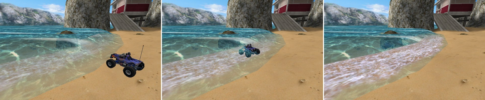
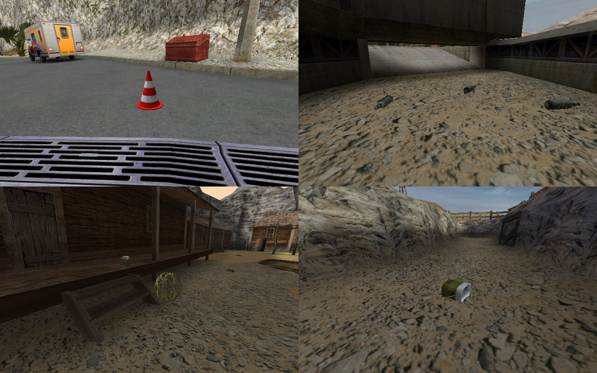
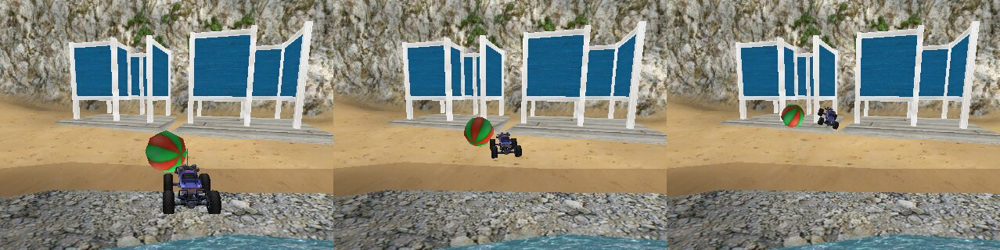

# OpenRCCars

Szkielet open-source'owej reimplementacji **RC Cars** (Creat Studio, 2002) na silniku
[Tempest](https://github.com/Try/Tempest), tym samym, na którym działa OpenGothic.

Projekt nie zawiera żadnych danych gry. Wczytuje assety z legalnie kupionej instalacji
(Steam/GOG): `RCCars.pack` oraz `RCCarsDB/*.sb`.


## Co już działa

- **RCCars.pack**: odczyt katalogu i deszyfrowanie plików (XOR ze strumieniem klucza `CREATSTUDIOGames`, k → 3k+1)
- **.csi**: dekodowanie tekstur (RGB565, RGB888, ARGB8888, ARGB4444, ARGB1555, A8I8) z klasyfikacją przezroczystości;
  wszystkie 1316 tekstur z archiwum dekodują się poprawnie
- **.sb** (CREAT Studio Scene Project 6.0): hierarchia węzłów, siatki, UV, normalne, warstwy tekstur
  (BAS1/LM_1/ALP1/BAS2), osadzone lightmapy, markery (checkpointy `cp_*`); wszystkie 18 plików parsują się poprawnie
- **renderer**: trasa z teksturami, lightmapami, mieszaniem tekstur terenu, alpha-testem, przezroczystością i mgłą;
  przełączanie 10 tras
- **auto**: model z `Car.sb` (Overkill, Buggy, Hummer) stoi na pozycji startowej gracza (`INST 'Player'`), osadzony
  na ziemi; nadwozie i koła są osobnymi częściami (pod obrót i skręt kół); kamera za autem albo kamera swobodna;
  kamera za autem nie schodzi pod wodę, a karoseria, szyby i chromy mają odbicia z mapy otoczenia jak w oryginale
- **kolizje trasy** z węzła `COLL`: siatka komórek nad trasą, w każdej lista ścian siatek renderu, które ją przecinają;
  z tego powstaje siatka kolizji (trójkąty w przestrzeni świata) z raycastem po komórkach (DDA). Auto staje na
  ziemi wyznaczonej raycastem. Klawisz **K** pokazuje nakładkę kolizji: zielone podłoże, żółte zbocza, czerwone
  ściany, niebieskie niewidoczne ściany (ściany bez tekstury)
- **fizyka jazdy** jak w `RCCars.exe`: własny model auta (sprężyny, opony z poślizgiem, koła jako kule) na
  [Bullecie](https://github.com/bulletphysics/bullet3), który porusza nadwozie i zderza je z trasą i rekwizytami.
  Nadwozie to 9 kul z `cdt<N>.ini`, koła to kule wisące na sprężynach i opadające na trójkąty siatki `COLL`
  (ściany, słupy, niewidoczne bariery) i rekwizyty. Parametry każdego auta z
  `Settings/engine|springs|tires|steering|resistance|cdt<N>.ini`, silnik, dopalacz, turbo, skręt, skok, opory oraz
  głęboki piasek i woda tak jak w kodzie `RCCars.exe` (krzywa `Splines/OVERKILL|BUGGY|HUMMER.bspl`, zob. „Fizyka wg
  `RCCars.exe`”), ulepszenia (dopalacze, rezonatory, opony) z `Scripts/upgrades.ini`. Koła kręcą się, skręcają i pracują na
  zawieszeniu; hamulec przy skręcie powyżej `angleDriftOn` puszcza tył w poślizg; klawisze jak w instrukcji oryginału (`Instrukcja.pdf`: spacja skok, Shift dopalacz, B blokada kół);
  zbiornik turbo ładuje się sam i dostaje 10 jednostek za każdy punkt kontrolny; skok +3 m/s w górę auta (spacja
  na przewróconym aucie stawia je na koła); auto przewrócone na dach wraca na koła po 2 s
- **nawierzchnie i woda**: rodzaj nawierzchni pochodzi z bitów materiału tekstury (`GLTX`): piasek, mokry piasek,
  głęboki piasek (`Sand_trample`), żwir i reszta. Jak w danych oryginału, jazdę zmieniają tylko głęboki piasek i woda
  (`Settings/tires<N>.ini`: `coeffDeepSand`, `coeffWater`; Hummer na dużych kołach mniej traci w wodzie); pozostałe
  nawierzchnie różnią się w oryginale tylko kurzem spod kół. Woda (tekstura `sea`: morze, strumienie, kałuże;
  wodospady są tylko do oglądania) nie jest twarda: auto brodzi w płytkiej wodzie i zwalnia, w głębokiej tonie i
  wraca do ostatniego punktu kontrolnego, jak w instrukcji („jeśli utoniesz w morzu”). Jak w `RCCars.exe`
  (0x508a10): liczy się punkt 0,2 m nad początkiem układu auta (u nas ~0,22 m nad spodem kół, przy dachu na 0,29 m),
  auto tonie po 2 s z tym punktem pod wodą, po 0,5 s, gdy jest głębiej niż 0,5 m pod powierzchnią; wynurzenie zeruje
  licznik. Tam też wraca po klawiszu R, po wyjechaniu poza pudło kolizji trasy (w bok albo 0,1 m pod jego dno,
  0x508160) i po chwili w strefie `car_reset_volume_*` (beach_2, beach_3, country_2, country_4; czas `FilterTime` ze
  skryptu strefy, od 10 ms do 3 s; 0x509690).
- **wyścig**: odliczanie 3, 2, 1, „Jazda!” z dźwiękami startu `cp_start` i `prestart` (auto stoi do startu), 3, 5
  albo 7 okrążeń, czas całkowity i czas okrążenia, najlepsze okrążenie, „zły kierunek”, meta z tabelą czasów i
  „jeszcze raz”.
  Liczą się główne punkty kontrolne `cp_N` (na beach_1 cztery, każdy z kolorowym graffiti na ziemi): okrążenie to
  przejechanie ich wszystkich po kolei, jak w instrukcji, a R wraca na ostatni zaliczony. Jak w RCCars.exe punkt
  zalicza się, gdy auto minie jego marker bliżej niż 1,6 m (liczone w 3D), i sprawdzany jest tylko następny w
  kolejności. Pośrednie `cp_N_M` prowadzą strzałkę i „zły kierunek” (strzałka idzie dalej, gdy auto przetnie linię
  punktu do 15 m od niego albo podjedzie bliżej niż 4 m od boku jego korytarza). Tak jak w oryginale na country_3
  da się zaliczyć `cp_3` wcześnie: stoi 2,2 m od drogi przy wjeździe w pętlę, którą trasa objeżdża dwa razy. Kokpit rysujemy obrazkami
  z gry (`Language/Polish` albo `Language/English`: odliczanie, „okrążenie”, komunikaty, czcionka `Smash26`; czas, numer okrążenia i liczby na zegarach metalicznymi cyframi `cock_num`, które oryginał trzyma w samym `RCCars.sb`)
  w miejscach z `Settings/cockpit.ini`; strzałka kierunku to jak w oryginale bryła 3D `Arrow` z `cockpit.sb`
  (dwa szewrony), która obraca się w stronę dalszej drogi, zmienia kolor z zielonego przez żółty na czerwony, gdy
  zbliżasz się do następnego punktu, jest czerwona i miga przy jeździe w złą stronę. Nad następnym głównym punktem wisi animowana strzałka z gry
  (`cp_ar_2_f1..3` zielona, a nad `cp_1`, gdzie kończy się okrążenie, czerwona `cp_ar_3_*`), z rozmiarem i odległościami
  z `Settings/anim_cp.ini`. Na dole zegary z gry (`cockpit_sp1`/`cockpit_sp2`/`cockpit_sp4`): dopalacz po lewej,
  prędkość po prawej (pełny przy 50 km/h); pod numerem okrążenia mapa trasy (`trackmap_<n>`) wokół auta w ramce
  `messagebox`, z punktami głównymi (`map_cp`, następny świeci) i autami (`map_arrow`: gracz i przeciwnicy); strzałka kierunku
  w nawiasach z `overtaking.csi`; w lewym górnym rogu miejsce (`place1..6`) w wyścigu z przeciwnikami. Czas i numer
  okrążenia metaliczne jak w oryginale, czas okrążenia miga pod czasem tylko po jego ukończeniu. Spoza
  oryginału są tylko kule zaliczania punktów (1,6 m) obrysowane na trasie do debugowania (klawisz G, domyślnie wyłączone): następna główna zielona, kolejna żółta,
  zaliczone w tym okrążeniu szare, zaliczona przed chwilą miga na zielono, pośrednia, na którą wskazuje strzałka,
  niebieska. Każde zaliczenie trafia też do logu
- **przeciwnicy**: jak w oryginale, dopóki nikt ich nie potrąci, nie jeżdżą z fizyką, tylko odtwarzają przejazdy nagrane na każdej trasie
  (`CarProfiles/<trasa>/*.dat`). Skład wyścigu (do pięciu kierowców, auto, nagranie) jest w `Scripts/ailayouts.ini`;
  na łatwym startują trzej, na normalnym czterej, na trudnym wszyscy (klawisz O, domyślnie normalny). Nagranie to
  jedno okrążenie od startu, którego koniec schodzi się z początkiem pętli; kolejne okrążenia kierowca jedzie z
  odmian tego nagrania (`over1`, `over1_2`, `over1_3` …) po kolei. Tempo odtwarzania jest takie jak w `RCCars.exe`:
  współczynnik trasy (`CoeffCommonOpponents`, 0,85–0,97) razy poziom trudności (`Scripts/aiCommonCoeffs.ini`:
  0,92 / 1 / 1,07) razy „gumka” (`Splines/FuncWaitAccel<n>_A.bspl`): kto jest 40–50 m za graczem, jedzie do
  1,1–1,2 raza szybciej, kto 20–45 m przed nim, zwalnia do 0,6–0,65. Gracz staje na swoim miejscu w szyku
  (`PlayerPath`, `start.dat`). Kierowcy (Doc, BabyShark, Daisy, Dakilla, Johny, MCJocker, MaxXMad) mają swoje
  malowanie auta (`car_askin<auto><1–4>`). Odtwarzając nagranie, są bryłą kinematyczną (pchają rekwizyty).
  Gdy dotknie ich inne auto, wypadają z nagrania (`RCCars.exe` 0x533990 → 0x4fd9d0): stają się autem z fizyką
  jak gracz (parametry swojego auta, ta sama masa 1 kg, więc się przepychają, obracają i przewracają), a autopilot
  z gry (0x4fdb50–0x4fe490) prowadzi je z powrotem na nagranie: celuje w punkt nagrania 2,7 m przed najbliższym
  (szukanym do 6 m naprzód), prędkość 4–10 m/s zależnie od odległości do celu, mniejsza przy ostrym skręcie,
  koła do 35° (przez pierwszą sekundę co najmniej 30°, z prędkością 90°/s); zablokowane (wolniej niż 2 km/h
  albo dociśnięte do przeszkody) cofa przez 1,5 s. Po 2 s wraca do odtwarzania, gdy jest 10 cm od punktu
  nagrania i jedzie w jego kierunku (do 10°), a po 5 s wraca od razu, jeśli gracz go nie widzi (u nas: dalej niż
  50 m albo za graczem, zgadnięte). Powrót płynnie przechodzi w nagranie przez sekundę. Przy zderzeniu wolniejsze
  auto (przy podobnej prędkości przeciwnik) dostaje impuls lekko w górę, bo gra liczy jego środek 10 cm wyżej.
  Przeciwników obowiązują te same zasady powrotu na trasę co gracza (utonięcie, pudło kolizji, strefy
  `car_reset_volume_*`), a wypchnięty z nagrania wraca od razu po wjechaniu w dowolną strefę (0x4fe3f0). Trafia na
  ostatni minięty główny punkt kontrolny (przed pierwszym na swoje miejsce na starcie) i stamtąd autopilot prowadzi
  go z powrotem na nagranie (0x508b50).
  Kokpit pokazuje miejsce obrazkiem z gry
  (`place1..6.csi`: „1szy” … „6ty”), a meta tabelę wyników, w którą wpadają czasy kolejnych kierowców
- **obiekty na trasach** (węzły `INST`): rekwizyty ze `stone.sb` (puszki, butelki, piłki, wiadra, pachołki, czajniki,
  baloniki, łuski, toczące się kłębki) stoją tam, gdzie kładzie je trasa (od 8 do 17 na trasie), i są bryłami
  sztywnymi: auto je potrąca, przewraca i pcha, a koła po nich przejeżdżają. Masa, sprężystość, tarcie, kształt
  (kula, walec albo otoczka wypukła modelu) i środek masy pochodzą ze skryptu `SCRI` każdego modelu. Ruch uliczny
  (`Roadcar.sb`) jeszcze się nie pojawia
- **ludzie i zwierzęta** (`people.sb`, `AIChars.sb`) zachowują się jak w `RCCars.exe`: plażowicze chodzą po
  nagranych ścieżkach (`Profiles/<nazwa>.dat`), kopią auto albo podnoszą je i rzucają; strażnicy obracają się do
  gracza, celują i kopią; mewy chodzą i odlatują z krzykiem, gdy ktoś podejdzie; kraby wychodzą z dziur i uciekają
  bokiem do morza; pająki biegają między dziurami, uciekają przed autem i giną pod kołami; psy gonią auto i
  szczekają; sępy krążą nad country_2. Potrącenie człowieka, strażnika albo psa to „Wielkie Łup!” i ich głos.
  Animacje szkieletowe są liczone na CPU
- **efekty spod kół**: kurz na piasku, mokrym piasku, głębokim piasku i żwirze oraz bryzgi wody, gdy koło tnie
  lustro wody, jak w `RCCars.exe`: ustawienia z `Settings/car_dustx.ini`, `surf_*.crs` i `water_spray.crs`, krzywe
  intensywności z `Splines/dust_int.spl`, `dust_speed.spl`, `wspr_int.spl`, tekstury `dust` i `particle`. Auto gracza
  kurzy wszystkimi kołami, przeciwnicy tylko tylnymi i z krócej żyjącym kurzem. Oba efekty są w oryginale
  delikatne: kurz to półprzezroczyste kłęby rosnące przez sekundę, bryzgi to kilkupikselowe krople
- **ślady opon, kilwater, spaliny i brud**, też według `RCCars.exe`: koła zostawiają na piasku, mokrym piasku,
  udeptanym piasku, żwirze i drewnie ślady z bieżnikiem (`car_trace.ini`, tekstury `t_halfdry_tire2_N`), za kołami
  i karoserią w wodzie ciągnie się kilwater i piana (`wtr_trace.crs`, `whr_horse.ini`), z końcówki dopalacza lecą
  spaliny z dużym ciemnym kłębem przy włączeniu turbo (`exhausted_gas.ini`, `eg_int.spl`), a kurz spod kół
  powoli brudzi karoserię auta gracza, woda ją zmywa (tekstury `dirt_car*`)
- **narzędzia**: `rcinfo` (inspekcja/eksport danych i jazda testowa, bez GPU) i `rcshot` (render offscreen do PNG)










## Budowanie (Windows)

Wymagania:
- Visual Studio 2022 z obciążeniem *Programowanie aplikacji klasycznych w C++* (zawiera CMake)
- [Vulkan SDK](https://vulkan.lunarg.com/sdk/home) **1.4.357 lub nowszy** (Tempest używa nowych rozszerzeń; instalator ustawia zmienną `VULKAN_SDK`)
- Git (CMake przy pierwszej konfiguracji sam pobiera [Bullet](https://github.com/bulletphysics/bullet3) 3.25)

```bat
git clone --recursive https://github.com/maxis27/OpenRCCars.git
cd OpenRCCars
:: jeśli sklonowano bez --recursive albo rozpakowano z archiwum:
git submodule update --init --recursive

cmake -B build -G "Visual Studio 17 2022" -A x64
cmake --build build --config RelWithDebInfo
```

Uruchomienie:

```bat
build\bin\RelWithDebInfo\OpenRCCars.exe -g "D:\SteamLibrary\steamapps\common\RCCars"
```

Opcje: `-g <folder gry>` (domyślnie bieżący katalog), `-l <trasa>` (domyślnie `beach_1`),
`-dx12` (backend DirectX 12, eksperymentalnie), `-validation` (warstwy walidacji Vulkana).

### Linux

```sh
sudo apt install build-essential cmake ninja-build libx11-dev libxcursor-dev glslang-tools libvulkan-dev
cmake -B build -G Ninja -DCMAKE_BUILD_TYPE=RelWithDebInfo
cmake --build build
./build/bin/OpenRCCars -g ~/.steam/steam/steamapps/common/RCCars
```

Jeśli systemowe nagłówki Vulkana są starsze niż 1.4.357, ustaw `VULKAN_SDK` na katalog z aktualnymi
[Vulkan-Headers](https://github.com/KhronosGroup/Vulkan-Headers) (podkatalog `include`).

Same narzędzia do danych (bez Tempesta i GPU): `cmake -B build -DOPENRCCARS_TOOLS_ONLY=ON`.

## Sterowanie

Jazda (kamera za autem):

| Klawisz | Akcja |
|---|---|
| W / ↑ | gaz |
| S / ↓ | hamulec, po zatrzymaniu wsteczny |
| A / ← , D / → | skręt w lewo / w prawo |
| Spacja | skok (przewrócone auto: na koła) |
| Shift | dopalacz (zużywa turbo, ok. 10 s z pełnego zbiornika) |
| B | zablokuj koła (tylne, do poślizgu) |
| T | postaw auto na koła w miejscu |
| R | powrót do ostatniego głównego punktu kontrolnego (przed pierwszym: na start) |
| Enter | wyścig od nowa, od odliczania („Jeszcze raz”) |
| L | liczba okrążeń: 3 / 5 / 7 (i wyścig od nowa) |
| P, Pause | pauza |
| O | przeciwnicy: brak / łatwy / normalny / trudny (i wyścig od nowa) |
| U | następny poziom ulepszeń (0–3: dopalacze, rezonatory, opony razem) |
| 1 / 2 / 3 | auto: Overkill / Buggy / Hummer |

Pozostałe:

| Klawisz | Akcja |
|---|---|
| V | kamera za autem ↔ kamera swobodna (auto wtedy stoi) |
| K | nakładka kolizji (debug; turkusowa woda, fioletowy głęboki piasek) |
| G | kule zaliczania punktów kontrolnych, 1,6 m (debug, domyślnie wyłączone) |
| N | przeskok do następnego głównego punktu kontrolnego (debug, do sprawdzania okrążeń i mety) |
| W / S / A / D | ruch kamery swobodnej |
| E, Spacja / Q, C | w górę / w dół |
| Shift | szybciej ×4 |
| przeciąganie myszą, strzałki | obrót kamery swobodnej |
| kółko myszy | prędkość kamery |
| F1–F10 | trasy: beach_1–4, country_1–4, urban_1–2 |
| Esc | wyjście |

## Narzędzia

```sh
rcinfo <folder_gry> pack                          # statystyki archiwum
rcinfo <folder_gry> check                         # dekoduje wszystkie tekstury i sceny (test regresji)
rcinfo <folder_gry> sb RCCarsDB/beach_1.sb        # statystyki sceny, tekstury, markery
rcinfo <folder_gry> obj RCCarsDB/Car.sb car.obj   # eksport geometrii do OBJ
rcinfo <folder_gry> coll RCCarsDB/beach_1.sb [coll.obj]  # siatka kolizji: statystyki, test raycastu, eksport OBJ
rcinfo <folder_gry> drive RCCarsDB/beach_1.sb [auto 1-3] [ulepszenie 0-3]  # jazda testowa bez GPU (autopilot po checkpointach, z rekwizytami)
rcinfo <folder_gry> objects RCCarsDB/beach_1.sb   # obiekty na trasie (INST): model, rodzaj, fizyka; test opadania rekwizytów
rcinfo <folder_gry> race RCCarsDB/beach_1.sb [okrążenia]  # punkty kontrolne i test logiki wyścigu (bez fizyki)
rcinfo <folder_gry> gates RCCarsDB/beach_1.sb [auto 1-3]  # każdy główny punkt kontrolny zaliczony autem z fizyką
rcinfo <folder_gry> ai RCCarsDB/beach_1.sb [poziom 1-3] [okrążenia]  # przeciwnicy: nagrania, ich pętle i wyścig bez gracza
rcinfo <folder_gry> fx                            # ustawienia efektów, ile cząsteczek, śladów i kilwatera daje auto na każdej nawierzchni
rcinfo <folder_gry> ram RCCarsDB/beach_1.sb [przeciwnik] [s] [side]  # gracz wjeżdża w przeciwnika: wypadnięcie z nagrania, powrót, „Łup!”
rcinfo <folder_gry> drown RCCarsDB/beach_1.sb [auto 1-3]  # strefy powrotu, pudło kolizji, czas tonięcia na kilku głębokościach (też przeciwnika)
rcinfo <folder_gry> extract "Scripts\upgrades.ini" upgrades.ini
rcinfo <folder_gry> csi "Textures.1\ang_dor.csi" ang_dor.tga
rcshot <folder_gry> beach_1 shot.png [w h] [x y z yaw pitch]   # render offscreen, z autem i kamerą za nim
RCSHOT_CAR=Car3 rcshot ...                                      # inne auto (Car1/Car2/Car3), none = sama trasa
RCSHOT_COLL=1 rcshot ...                                        # z nakładką kolizji
RCSHOT_DRIVE=3 RCSHOT_STEER=1 rcshot ...                        # najpierw 3 s jazdy na pełnym gazie, druga połowa ze skrętem
RCSHOT_DRIVE=2 RCSHOT_JUMP=1.6 rcshot ...                       # skok w 1,6 s, zdjęcie w 2 s
RCSHOT_DRIVE=3 RCSHOT_BOOST=1 rcshot ...                        # z dopalaczem
RCSHOT_DRIVE=1 RCSHOT_JUMP=0.8 RCSHOT_VIEW=90,0.6 rcshot ...   # z bliska, z lewego boku auta (0 = z tyłu), z 0,6 m
RCSHOT_START="-8 -41 90" RCSHOT_DRIVE=1.6 rcshot ...            # auto najpierw w punkcie x z, obrócone o yaw (tu: do morza)
RCSHOT_TIME=2.5 rcshot ...                                       # chwila animacji wody (fale, piana)
RCSHOT_OBJECTS=0 rcshot ...                                      # bez rekwizytów
```

## Struktura

```
formats/        formaty danych, czyste C++ bez zależności
  chunk.h       wspólny format elementów [id][typ][koniec]
  pack.*        RCCars.pack + deszyfrowanie
  csi.*         tekstury
  scene.*       sceny .sb
  collision.*   siatka kolizji z węzła COLL, raycast, nawierzchnie
  settings.*    pliki suwaków Settings/*.ini i *.crs, Scripts/upgrades.ini, krzywe .bspl i .spl
  objects.*     modele obiektów z INST: w którym pliku leżą (stone.sb, people.sb, AIChars.sb, Roadcar.sb)
  carprofile.*  nagrane przejazdy przeciwników (CarProfiles/*.dat), Scripts/ailayouts.ini
  skeleton.*    szkielet modelu .sb: kości, sekwencje ASEQ, poza w chwili animacji
  actorpath.*   ścieżki postaci (Profiles/<nazwa>.dat) i lotu sępów (Profiles/vlt_*.gpf)
physics/        fizyka jazdy (Bullet, bez GPU)
  cargeometry.* koła i nadwozie auta z Car.sb
  carparams.*   parametry auta z ustawień gry
  carrig.*      jak oryginał rysuje koła i zawieszenie: wychylenie osi, wahacze, skręt, amortyzatory
  vehicle.*     świat Bulleta trasy, auto jak w RCCars.exe (sprężyny, opony, kule kół), nawierzchnie i woda
  checkpoints.* punkty kontrolne w kolejności, zaliczanie (1,6 m), postęp auta, powrót do ostatniego punktu
  race.*        wyścig: odliczanie, okrążenia, czasy, zły kierunek, meta
  props.*       rekwizyty: parametry ze skryptu SCRI, kształt, bryła sztywna
  characters.*  ludzie i zwierzęta: zachowanie każdego rodzaju, kopnięcia i rzuty autem, „Wielkie Łup!”
  opponents.*   przeciwnicy: odtwarzanie nagrań w tempie z gumką, okrążenia, kolejność w wyścigu
fx/             efekty cząsteczkowe, bez GPU
  particles.*   emiter i cząsteczki jak system cząsteczek RCCars.exe
  careffects.*  efekty auta: ustawienia, kurz, bryzgi, spaliny, brud; sprite'y i czworokąty do narysowania
  tracks.*      ślady opon: pierścień punktów na koło, łączenie w pasy, zanikanie
  wake.*        kilwater i piana na wodzie wokół kół i karoserii
  marks.h       czworokąty leżące w świecie (ślady, kilwater, piana)
game/           gra (Tempest)
  resources.*   dostęp do instalacji gry, cache tekstur
  camera.*      kamera swobodna
  hud.*         kokpit wyścigu (obrazki i czcionka z Language/<język>)
  effects.*     efekty aut gracza i przeciwników: sprite'y zwrócone do kamery, posortowane, z testem głębi
  world/        Level (trasa), LevelMesh (geometria na GPU, batche po teksturach), ModelMesh (auto, obiekt),
                Objects (rekwizyty trasy), CollisionView (nakładka kolizji)
  mainwindow.*  okno, pętla, wejście
shader/         GLSL kompilowany do SPIR-V i wbudowywany w plik wykonywalny
tools/          rcinfo, rcshot
lib/Tempest     silnik (submoduł git)
```

## Ustalenia o danych

- Sceny są **prawoskrętne, oś Y w górę** (eksport z Mayi). Potwierdzone porównaniem renderu z góry z mapą trasy
  z menu gry (`Textures.1/shot_beach1_L.csi`) oraz czytelnymi napisami na szyldach.
- Ściany mają odwrotne nawinięcie względem domyślnego w Tempeście; nieprzezroczysta geometria używa `CullMode::Front`.
- Siatki z sufiksem `_LOD<n>` to kopie pod tym samym rodzicem. Przy obiektach pełna siatka nie ma sufiksu, a `_LOD1`/`_LOD2`
  to uproszczenia (pomijane). Morze składa się wyłącznie z LOD-ów: `_LOD1` jest najgrubszy, najwyższy numer najdokładniejszy,
  a grupy daleko od trasy mają tylko `_LOD1`/`_LOD2`. Rysujemy najdokładniejszy z każdej grupy (wcześniej znikały całe
  połacie morza i było widać dno).
- Zaszyfrowany plik w archiwum to `[31 14][u32 koniec][u32 rozmiar][dane]`; rozmiar w katalogu to rozmiar samych danych,
  więc cały blok jest o 10 bajtów dłuższy (wcześniej czytaliśmy o 10 bajtów za mało i "brakowało" końcówek plików).
- `Settings/*.ini` to pliki suwaków narzędzia do strojenia: `Key "nazwa"`, `Values min max pozycja`, opcjonalnie
  `Mask float` + `FValues od do` (pozycja przeliczana liniowo na ten zakres) albo `Mask spline` (nazwa pliku `.bspl`).
  Obok leżą skompilowane `.crs` (nazwy XOR 0x25), ale ze starszymi wartościami; czytamy `.ini`.
  `RCCars.exe` przelicza każdy suwak liniowo z pozycji 1..100 (bez względu na zakres zapisany w pliku) na własny,
  wpisany w kod zakres; tam, gdzie go znamy, `physics/carparams.cpp` robi to samo (zob. „Fizyka wg `RCCars.exe`”).
- `Splines/*.bspl` z edytora krzywych: punkty kontrolne to elementy `5b/80` z trzema floatami `(0, x, y)`.
  Silnik auta to `OVERKILL|BUGGY|HUMMER.bspl`: przyspieszenie (y, m/s²) od prędkości (x, km/h), Overkill 6 → 0 przy
  32 km/h, Buggy 9 → 0 przy 38, Hummer 4 → 0 przy 30. `splAccelBase<N>.bspl`, `splAccelGrav<N>.bspl`,
  `Height2Stiffness.bspl`, `AngleSteer2RearDrift.spl` i `Settings/Water.ini` zostały w danych z edytora; `RCCars.exe`
  ich nie czyta.
- Auto: osie X w lewo, Y w górę, Z do przodu; koła `WHEEL_FRONT_LEFT` itd. (Hummer ma 6 kół). Fizyka liczy w Bullecie
  w skali ×10 (z grawitacją ×10), bo Bullet nie lubi obiektów 0,4 m; na zewnątrz wszystko jest w metrach.
- **Fizyka wg `RCCars.exe`** (odszyfrowany kod, tylko do analizy). Oryginał ma własny silnik fizyki: auto waży 1 kg,
  grawitacja to 10 m/s², więc siły są przyspieszeniami. Suwak `s` (1..100) przechodzi w `od + (s-1)·(do-od)/99`:
  - silnik (`engine<N>.ini`): bez dopalacza przyspieszenie = krzywa auta w punkcie `v·3,6 / (gaz · RESONATORS)`,
    razy `RESONATORS *_SPL_OY`; powyżej `speedBaseMax + 0,1` km/h × `RESONATORS` silnik nie ciągnie. Z dopalaczem
    krzywa jest rozciągnięta o `speedBoostMax / speedBaseMax`, ×1,2, a limit to `speedBoostMax + 0,1`. Kiedy silnik
    ciągnie, dodaje też opór (niżej), więc na płaskim auto przyspiesza dokładnie wg krzywej. Wsteczny: 4 m/s²
    (z dopalaczem 6) do 2,83 m/s, dalej malejąco do zera przy 3,33 m/s (12 km/h);
  - opór (`resistance<N>.ini`): `a = coeffAirResistance·v² + coeffFrictionBearings` przeciw ruchowi, zakresy 0..0,1
    i 0..10 (Overkill 0,032 i 0,51);
  - turbo: zbiornik w jednostkach, pełny ma od 50 do 100 jednostek, zależnie od tempa ładowania
    (`boostSpeedUp` 0,1..1,5 × `BOOSTERS`) na tle najwolniejszego (Buggy bez ulepszeń) i najszybszego (Hummer
    z pełnymi). Na starcie jest pełny, ładuje się sam (`boostSpeedUp · BOOSTERS · 0,95` jedn./s), za każdy punkt
    kontrolny +10, z wciśniętym dopalaczem schodzi `boostSpeedDown` (1..10, 5,45 jedn./s). Gdy się opróżni przy
    wciśniętym klawiszu, dopalacz rusza znowu po 0,9 s i dopiero powyżej 10 jednostek. `BOOSTERS` nie zmienia
    przyspieszenia, tylko ładowanie turbo;
  - „Łup!” i „Wielkie Łup!” (`msg_hits.csi`, przez 1 s, ważniejsze od „złego kierunku”): każde daje +5 jednostek
    turbo. „Łup!” za dotknięcie rekwizytu ze `stone.sb` szybciej niż 7 km/h (najwyżej co 0,3 s). Po uderzeniu
    w przeciwnika (oba auta co najmniej 2 s od poprzedniego) gra przez 0,5 s sumuje obrót **przeciwnika** w jego
    osiach (0x5334b0): średnio ponad 3 rad/s wokół X, 5 wokół Z albo 7 w sumie to „Wielkie Łup!”, ponad 0,8 / 1 / 2
    to „Łup!”, czyli liczy się, jak mocno gracz nim rzucił. Ludzie, strażnik (od 10 km/h) i pies
    (od 15 km/h) dają „Wielkie Łup!” (najwyżej co 2 s); kraby, pająki, mewy i ruch uliczny nic;
  - skręt: pozycja kierownicy rośnie w stronę wciśniętą o `4,5 - 0,5·v` (v w m/s, najmniej 1) na sekundę, wraca
    (i przechodzi na drugą stronę) o 6 na sekundę; `steering<N>.bspl` zamienia ją na kąt kół (20° na jednostkę),
    który rośnie do `AngleSteer` (0..100, 29,3°). Pełny skręt nie maleje z prędkością, tylko wolniej się go nabiera;
  - skok (spacja, co najmniej 0,5 s od poprzedniego): +3 m/s wzdłuż osi „w górę” auta (Buggy 3,3) i obrót wokół
    pionu ×1,5; auto przechylone o ponad 80° zamiast skoczyć staje na koła;
  - auto (0x4f0910, 0x4f5e50): bryła sztywna o masie 1 kg, bezwładność prostopadłościanu całego modelu (Buggy
    ×2 wokół osi przód-tył), środek masy `CenterMassOY` (0..0,2 m) nad początkiem modelu; prędkość najwyżej 20 m/s,
    moment pędu najwyżej 1. Kule nadwozia z `cdt<N>.ini`: `CdtRadUp<i>` (0,01..0,3 m) w `CdtDeltaX|Y|Z<i>`
    (−0,3..0,3 m, Buggy `CdtDeltaZ_CENTRAL<i>`), każda trzy razy: na środku i przesunięta o `shiftRoofBaseLefter`
    w lewo i w prawo. Koło to kula `CdtRadWheel` (0,01..0,1 m, tylne × `coeffRadBackWheels` 1..2);
  - sprężyny (`springs<N>.ini`, 0x4f91b0, 0x4f0f80): `length` 0,01..0,5 m, `lenMin` × 0,1..0,9, `lenMax`
    × 1,1..2, ugięcie `kPos` = (length − lenMin) × 0,1..0,9, tłumienie `kSpeed` 1..10, mocowanie `touchPoint`
    (0..1 m) nad piastą. Sztywność k = m·g / (liczba kół · ugięcie). Koło dotykające ziemi pcha auto wzdłuż jego osi
    „w górę” siłą k·(length − długość − 0,02 r) − kSpeed·(zmiana długości)/dt, tłumienie najwyżej tyle co
    sprężyna; do ruchu liczy się tylko część wzdłuż normalnej podłoża, a moment w osiach auta razy
    `coeffMomentOX` (0,5..2, pochylenie) i `coeffMomentOZ` (1..3, przechył), bez obrotu wokół pionu.
    Koło wciśnięte w ziemię od razu idzie w górę (najwyżej do `lenMin`), w dół opada do spoczynku (`length`, a
    wolniej niż 5 km/h `length − 0,95·kPos`) z szybkością r (promień koła) na sekundę, a po t s jazdy szybciej
    niż 5 km/h r·(1 + 18·t), czyli 10·r od 0,5 s (0x4fb340);
  - rysowanie kół (0x504820 Overkill, 0x505780 Buggy, 0x5068e0 Hummer): gra nigdy nie przesuwa koła o długość
    sprężyny, tylko obraca węzły, na których koła wiszą, więc koła zostają na osiach. Sztywna oś (`FRONT_AXLE`,
    `REAR_AXLE`) wychyla się o atan(opad kół / `lenAxe`) (0,05..0,2 m), najwyżej 30° w dół i 90° w górę, i przechyla
    o atan(4 · różnica wysokości lewego i prawego koła). Hummer czyta kąty z tablic wysokości koła od kąta,
    zbudowanych przy wczytaniu auta (0x5065c0), czyli osie obracają się dokładnie tak, by koła były tam, gdzie
    sprężyny (najwyżej 20° w dół); środkowa oś przesuwa się w pionie najwyżej o tyle, o ile opada przednie koło
    przy 20° (0x14edd4c). Wahacze Buggy (`AXLE_*_UP`, `AXLE_*_DOWN`)
    obracają się tak, by zwrotnica z kołem (`AXLE_*_WHEEL`) była na wysokości koła, najwyżej `angleProcUpMax`
    w górę i `angleProcDownMax` w dół (0..90°, 35,5° i 26,4°). Przednie koła skręcają z wspornikami
    (`AXLE_FRONT_*_SUPPORT`), a amortyzatory między nadwoziem a osią lub wahaczem obracają się i rozciągają
    (Overkill: sięgają `SpringLength` z `WheelsVisual.crs`, 0,01..0,1 m, 77 → 0,079 m, wzdłuż osi Z węzła);
  - napęd (0x4eea50): siła silnika (najwyżej 20 × przyczepność tyłu) po połowie na tylne koła stojące na
    podłożu nachylonym mniej niż 46°, wzdłuż podłoża. Klawisz hamulca hamuje i przy |v| ≤ 2 m/s wrzuca wsteczny,
    gaz tak samo w drugą stronę (0x4ee5e0); hamując silnik nie ciągnie;
  - opony (`tires<N>.ini`, 0x4f7fa0, 0x4edac0, 0x4ee280): przyczepność `CoeffFrontTires|RearTires` 0,1..1
    × ulepszenie `TIRES`. Działają najwyżej w dwóch kołach, przednim i tylnym: przy mniej niż 3 kołach na ziemi
    w pierwszych dwóch dotykających, inaczej w zewnętrznych w zakręcie (jadąc prosto w prawych). Każde zatrzymuje
    poślizg w bok (hamując: każdy poślizg) siłą, która razem z drugą znosi przyspieszenie punktu koła od reszty sił
    (najwyżej 5 × przyczepność z przodu, 10 × z tyłu) i jego prędkość w tym kierunku (najwyżej 10 × przyczepność
    na sekundę). Hamulec ze skrętem powyżej `angleDriftOn` (1..45°) to poślizg: tył ma przyczepność
    × `coeffDriftRear` (1..0,1) i oba koła limit 10. Z kołami prosto opony gaszą też obrót auta (1/s);
  - głęboki piasek i woda (`tires<N>.ini`, 0..1): każde koło w głębokim piasku dokłada `coeffDeepSand·v²` przeciw
    ruchowi w swoim punkcie, a w wodzie `coeffWater·v²`, od zera przy kole zanurzonym w 30% do całości przy 90%;
  - R (co najmniej 1 s od poprzedniego) stawia auto na markerze ostatniego zaliczonego punktu, przodem w stronę
    następnego markera trasy; przed pierwszym punktem na starcie;
  - punkt kontrolny `cp_N` zalicza się, gdy auto gracza minie jego marker bliżej niż 1,6 m (auta AI: 2,88 m).
    `width`/`height`/`expand` z markerów (domyślnie z folderu `Checkpoints`, inaczej 2/1/0,1) opisują w oryginale
    korytarz trasy od markera do następnego, z którego liczy się postęp i miejsca w wyścigu.
- Indeksy tekstur `GLTX` są lokalne dla węzła `MODL`: w `Car.sb` każde auto (i każdy LOD) numeruje tekstury od zera.
- Zagnieżdżone markery (`cp_1` → `cp_1_1`, `cp_1_2` …) mają transformacje w przestrzeni świata, nie względem rodzica
  (w przeciwieństwie do siatek): kolejne podcheckpointy prowadzą od `cp_1` do `cp_2`.
- `COLL` (wewnątrz `DESC`) nie zawiera osobnej geometrii: to jednorodna siatka komórek (np. 156×12×320 po 0,5 m
  na beach_1) z listą par (siatka, maska bitowa ścian) na komórkę; indeksy komórek `z + nz*(y + ny*x)`, bity od
  najmłodszego. Kolizje używają więc geometrii renderu, łącznie ze ścianami bez tekstury (niewidoczne bariery)
  i niektórymi siatkami `_LOD*`. Zweryfikowane na wszystkich 10 trasach: każda ściana nachodzi na swoją komórkę.
- Nagłówek `GLTX` (element `0x08`) to tablica 5 liczb: indeks, 0, dwa słowa flag i **materiał**: bity
  4 mokry piasek, 5 piasek (`sand_halfdry`), 6 udeptany/głęboki piasek (`Sand_trample`), 7 drewno, 8 trawa, 9 żwir
  (`Sand_gravel`, `path_*`), 10 asfalt, 11 kamień/beton/skała, 12 metal (po jednym bicie na teksturę, na wszystkich
  trasach). `RCCars.exe` zna tylko `surf_default|sand|wetsand|dunesand|gravel` (`Settings/surf_*.crs`: same parametry
  kurzu), a z fizyki opon `coeffDeepSand` i `coeffWater`. Kolejność nazw i kolory kurzu pasują do bitów 4–6 i 9.
- Woda to ściany z teksturą `sea` (bez bitu materiału; `RCCars.exe` szuka jej po nazwie). Leżą w `COLL` jak reszta,
  w kilku kopiach `_LOD1`–`_LOD4` na tej samej wysokości. Poziom morza: 0 na beach_1, 2,15 na beach_3; dno pod nim
  to zwykłe ściany kolizji (na beach_1 piasek opada od -0,3 m przy brzegu do -1,4 m). Na country_1 płytkie kałuże
  (`pool1..3`), na country_3 strumień (kilka cm) i wodospady. `Settings/Water.ini` (`speedDropCenter` 125/500,
  `speedDropOther` 76/500, `DampingVelocity2` 950/1000) czytamy jako utratę prędkości przy wpadnięciu do wody
  nadwozia i kół oraz tłumienie pod wodą; to nasze odczytanie nazw.
- Woda wg kodu oryginału (`RCCars.exe`; kod jest zaszyfrowany zabezpieczeniem Steam, odszyfrowaliśmy go tylko do
  analizy). Morze to ściany `sea` pod węzłem, który ma plik `Settings/WLOD_<trasa>_<węzeł>.ini` (np.
  `WLOD_beach_1_more1.ini`; `formats/water.*`). Suwaki są przycinane do zakresu i skalowane: `amp`, `amp2`, `speed`,
  `length2` /100, `period`, `period2` /10, `angle` ×10°, `posX/posZ` −500, `offset` i `magnetOffset` /100 − 0,5 m,
  `magnetRadius` /20 m, `alphaRadius` /10 m. Wierzchołek morza ma wysokość
  `y0 + offset + (1−s)·magnetOffset + s·(fala1 + fala2)`, gdzie
  `fala1 = amp·(0,75·sin(period·(x·cos angle + z·sin angle + speed·t)) + 0,25)`,
  `fala2 = amp2·sin(|xz − środek|/length2 + period2·t)`, a `s = clamp(d/magnetRadius)` przy odległości `d` od brzegu
  morza (krawędzi siatki wody). Fala 1 przychodzi z kierunku `angle`, fala 2 to kręgi zbiegające się do `posX/posZ`.
  Na beach_1 `offset` to −0,37 m, więc morze leży poniżej piasku przy brzegu (−0,31 m) i styka się z plażą.
  Odległość od brzegu liczy się tylko wewnątrz bryły `water_box` (`EVOL`, beach_1, beach_3, country_3); poza nią
  `s = 1`. Krycie rośnie od 35/255 na brzegu do pełnego w odległości `alphaRadius`, ale tylko przy aucie: zwykła
  odległość `sqrt(dxz² + 187·dy²)` od auta między `distAlphaClampMin` a `Max` (0 i 8) przechodzi w pełne krycie.
  Szarość wierzchołka idzie od `colorMin` do `colorMax` z wysokością fali. Nie robimy `clampY*` (w znalezionym kodzie
  nieużywane) ani `alphaPow`. Odbicia: niżej, przy mapie otoczenia. U nas teselacja (`shader/water.tesc`, `water.tese`) dzieli morze przy kamerze
  co 15 cm (dalej co 2% odległości) i podnosi wierzchołki w GPU; bez teselacji robi to shader wierzchołków na
  oryginalnej siatce. Fizyka liczy wodę na tej samej wysokości co obraz (`y0 + offset`, bez fal).
- Piana przy brzegu to ściany `coast*` z teksturą `coast_base` i maską `ALP1` `coast` bez `BAS2`: maska to
  przezroczystość piany. Wg `RCCars.exe` piana idzie za falą 2 morza (`more1`): z `h = sin(faza fali 2)` w miejscu
  piany, gdy woda opada, krycie spada od `AlphaMax` (h = −1) do `AlphaMin` (h = 1), a gdy woda rośnie, do `AlphaMin`
  już przy `HeightOn` (`waterLOD_coast.ini`: `(v−100)/100`, czyli 0). Tekstura przesuwa się o `ScrollVel` (0,11) na
  sekundę. `HeightOff` jest wczytywane, ale nieużywane.
- Pozostała woda (kałuże `pool*` na beach_4 i country_1, strumienie `stream*` i wodospady `wtr_fall*` na beach_1 i
  country_3, bez fal w `WLOD`) jest płaska i przezroczysta wg głębokości nad dnem z kolizji (pełne krycie od 0,8 m).
  `RCCars.exe` (0x523260, tabela 0x575710: nazwa obiektu zawiera `stream`, `wtr_fall` lub `pool`) tylko przesuwa jej
  teksturę (strumienie i wodospady płyną, kałuże falują szumem `PoolNoiseFreq/Len` z `WaterLOD_Stream`), a jej
  wierzchołków nie rusza. Wodę pod autem szuka promieniem tylko w morzach i w obiektach `stream`/`pool`
  (0x51c240, 0x535120): wodospady nie są dla auta wodą. U nas tak samo (`CollisionMesh::isWater`).
- `EVOL` to bryły w scenie: dziecko `0x03` nazwa, `0xd0` kształt (u32), `0xd4` liczby; kształt 2 to graniastosłup
  `[ymin, ymax, x0, z0, x1, z1, …]` (wielokąt w XZ).
- Markery (`MARK`) mają w elemencie `0x04` właściwości wpisane w edytorze poziomów jako pary tekstów (lista
  `0x05 { 0x06 klucz, 0x07 wartość }`). Punkty kontrolne mają `width`, `height` i `expand` (np. beach_1 `cp_1`:
  szerokość 8, wysokość 1, expand 3); tam, gdzie ich brak (cały country_1, prawie cały country_2), przyjmujemy
  szerokość 6. W oryginale opisują korytarz trasy do następnego markera (z niego liczy się postęp i miejsca), a nie
  zaliczanie punktu; u nas szerokość pomaga tylko strzałce. Główne markery `cp_N` wiszą najwyżej 0,5 m nad ziemią,
  pośrednie do 2,7 m. Numeracja podpunktów ma dziury
  (country_1: `cp_4_3`, `cp_4_5`) i nie zawsze idzie po kolei w pliku, więc sortujemy po numerze.
  `rcinfo race` przejeżdża wszystkie 10 tras po linii markerów (i drugi raz obok punktów pośrednich) i zalicza
  każde okrążenie, a `rcinfo gates` dojeżdża autem z fizyką do każdego z 50 głównych punktów (rusza kilka metrów
  przed nim) i wszystkie się zaliczają.
- Zegary i mapa: `indicatorAngMin`/`indicatorAngMax` z `cockpit.ini` (−34° i 127° od góry, zgodnie z ruchem
  wskazówek) to dokładnie początek i koniec żółtej skali `cockpit_sp1` i czerwonej `cockpit_sp2` wokół środka tarczy
  (130; 126,6 z 256). Ze zrzutu oryginału: rurka wypełnia się na czerwono od dolnego końca (zero) w górę, nad
  wartością jest żółta do tego, co auto może osiągnąć (zbiornik dopalacza, prędkość maksymalna z dopalaczem;
  tam ciemna zatyczka z `cockpit_sp4`), dalej szara (szara rurka z `cockpit_sp2` obrócona o 184°); na wartości
  srebrna obejma z `cockpit_sp4`. Rozmiar
  i miejsce zegarów zmierzone z obrazka kokpitu w opcjach (`opt_cock_all`; `opt_cock_[aclm]_*` pokazują części
  kokpitu: miejsce i tabela, mapa, czat i turbo). Mapy `trackmap_1..10` (512x512) są obrócone dowolnie; która należy
  do której trasy i jak leży na niej świat, dopasowaliśmy do pomarańczowych kropek (to `map_cp` w miejscach głównych
  punktów `cp_N`) i do narysowanej trasy: beach_1..4 → 1, 6, 3, 10; country_1..4 → 8, 5, 2, 9; urban_1..2 → 7, 4
  (tabela `TrackMaps` w `game/hud.cpp`; odchyłki do kilku texeli). `map.ini` podaje róg mapy (620, 79).
  `cockpit.sb` to model świateł startowych (`light1..3`, `lightsframe`), ale jego tekstur nie ma w paczce.
- Kokpit: `Settings/cockpit.ini` i `cockpit_time.ini` podają pozycje na ekranie 800x600 (np. `lapPosX` 713 → x 613,
  `timeTotalPosY` → y 6, `msgOffsetY` → komunikaty 142 px nad środkiem, `timeLapBlinkInSec` 4,2 s). `anim_cp.ini` (`Size` 146, `Shift` 128,
  `MinDist` 237, `MaxDist` 900, `BlinkDelta` 10): `Shift` to texele obrazka wysokiego na 256, więc jest podniesiony
  o połowę wysokości i cień narysowany u jego dołu leży na ziemi pod markerem; resztę czytamy jako centymetry
  i setne sekundy: strzałka ma 1,46 m, znika bliżej niż 2,37 m od kamery, dalej niż 9 m trzyma rozmiar na ekranie
  (rośnie w górę od ziemi), klatka co 0,1 s (zgadnięte; kod gry, który to czyta, nie jest rozpracowany). Obrazki z napisami są w `Language/<język>/*.csi`
  (poza archiwum), `msg_321_s_f.csi` to „3”, „Jazda!”/„GO!”, „2”, „1”, „meta”/„Finish” w jednej teksturze.
  Czcionka `Smash20/26.csi` to siatka 10 kolumn × 9 wierszy (25,6 × 28,4 px) ze znakami w kolejności z `Smash*.dat`;
  szerokość liter mierzymy z kanału alfa. Teksty w `Language/Game/*.tbl` są zaszyfrowane, więc napisy tabeli
  wyników są na razie wpisane w kod. Liczbę okrążeń (3, 5 lub 7) wybiera się w oryginale w menu.
- Odliczanie to skrypty w `RCCars.sb` (`IRCS`): `RaceEntry` ma `1.0 Show3`, `2.0 Show2`, `3.0 Show1`, `4.0 StartRace`
  (sekunda bez niczego, potem cyfry), `RaceAgain` („jeszcze raz”) to samo bez tej sekundy, start po 3 s. Polecenie
  `Show3` w `RCCars.exe` (0x4e2060 → 0x52a6a0) gra dźwięk 2 kanału `Checkpoint` (`cp`, `cp_beside`, `cp_start`,
  `cp_reset`, `cp_wrongway`), czyli `cp_start.wav`, i kanał `Prestart` (`prestart.wav`, 9 s) naraz. Dźwięki są w
  archiwum w `Sound\*.wav` jako zwykłe PCM 16 bit. Światła startowe z `cockpit.sb` (`lightsframe`, `light1..12`)
  oryginał pomija: wczytuje ten plik jako model `Arrow` tylko dla strzałki `extru9`, a tekstur świateł nie ma w archiwum.
- Strzałka kierunku (`RCCars.exe` 0x4af3c9, 0x4b0fa0, 0x4b1360, 0x4e8f00): model `Arrow` z `cockpit.sb` to dwa
  szewrony (`extru9` z bokami `extru9_2_body` i 0,324 m za nim `extru9_3` z `extru9_1_body`), wszystko z teksturą
  `coc_str_2`, rysowane bez światła i bez przezroczystości (boki biorą srebrny pasek z dolnej, przezroczystej części
  tekstury). Gra szuka `extru9` i `extru9_3` i nadaje im kolor ARGB z v = 512·k: czerwony min(512−v, 255), zielony
  min(v, 235), bez niebieskiego, czyli k = 1 zielony, 0,5 żółty, 0 czerwony. k dąży (1 na sekundę) do drogi, jaka
  została do następnego głównego punktu, podzielonej przez drogę od poprzedniego do niego; w złą stronę do 0.
  Kamera z `Settings/arrow.ini` (zastępuje `Arrow_cam` z `RCCars.sb`): `NearPlane` 10 mm, pole widzenia `AngleVert`
  45° w poziomie i w pionie, kwadrat `Len` 17 % szerokości i wysokości ekranu ze środkiem w `CX` 50 %, `CY` 87 %,
  kamera w (0; (`pos_y`−200)/100; (`pos_z`−200)/100) = (0; 1,12; 1) patrzy na (0; cos 39°; sin 39°), gdzie 39° to
  `dir` − 90. Model obraca się wokół osi pionowej najwyżej o 90° na sekundę (10 razy szybciej, kolor też, zaraz po
  zaliczeniu punktu, dopóki nie wskaże nowego kierunku z dokładnością do 1°). Miga (0,25 s widać, 0,25 s nie) przy
  jeździe w złą stronę i gdy auto było już bliżej niż 5 m od następnego punktu, ale go nie zaliczyło. Kierunek
  w oryginale to kierunek korytarza trasy, na którym jest auto (albo prosto na punkt poza korytarzami), a zła
  strona to 6 s jazdy przeciw niemu; u nas strzałka wskazuje pośredni punkt `cp_N_M`, a zła strona zostaje z
  `rc::Race`.
- `CarProfiles/<trasa>/<nazwa>.dat` (nagrania przeciwników) mają ten sam format elementów co sceny: nagłówek
  `0x60` (m.in. `g` = 136, długość klatki, i teksty „Time path FULL: 68.185939”, „CYCLE: 65.022942”), `0x63`
  (liczba klatek, czas), `0x64` klatki, `0x65` lista zdarzeń (nieużywana). Klatka (ok. 100 na sekundę) to pełny
  stan auta: czas, pozycja początku układu modelu, kwaternion (w x y z), prędkość, prędkość kątowa, 4 długości
  zawieszenia, obroty kół (?) i na końcu słowo klawiszy (0x01 gaz, 0x10 prawie zawsze z nim, 0x20 zdarzenie z
  numerem w górnych 16 bitach; `RCCars.exe` 0x5029b0). Nagranie to jedno okrążenie od miejsca w szyku: od czasu
  FULL − CYCLE do końca to pętla (koniec 0,01–0,25 m od jej początku). Odmiany `_2`, `_3` zaczynają się tak samo
  i inaczej jadą okrążenie; `_3` bywają skrótami (`surf\over1_3` omija pętlę `cp_4_1` … `cp_4_6`), więc okrążenia
  przeciwników liczymy po przejechaniu `cp_1` (do 2,88 m, jak auta AI w grze) pod koniec nagrania, a nie po kolejnych punktach. Trasy w `ailayouts.ini` i
  `championship.ini` mają nazwy z gry: 1 Surf (beach_1), 2 Fishers (country_3), 3 Fort (beach_3), 4 AAD (urban_2),
  5 Mines (country_2), 6 Camping (beach_2), 7 Avax (urban_1), 8 Rancho (country_1), 9 Silo (country_4),
  10 War path (beach_4). `Demo*` to długie (ok. 220 s) nagrania do dema. Odtwarzanie w `RCCars.exe`: czas
  nagrania rośnie o `dt` × współczynnik (0x503430), współczynnik to `CoeffCommonOpponents` × poziom trudności ×
  wartość krzywej `FuncWaitAccel<n>` w odległości przeciwnika przed graczem wzdłuż trasy (0x4fd4b0, 0x4fd5d0);
  szybki wyścig bierze krzywe `_A` (0x4fd6e2). `Settings/OpponentBehav.ini` (`distEquil`, `coeffWait*`,
  `coeffAccel*`) i `Scripts/aiShiftsFuncWaitAccel.ini` należą do innych trybów i jeszcze ich nie używamy. Które z
  odmian nagrania i w jakiej kolejności bierze oryginał, nie wiemy; malowanie `Skin` 1–3 czytamy jako drugą do
  czwartej tekstury `car_askin<auto>N` (pierwszą ma model i gracz), to też zgadnięte.
- Start auta gracza to `INST 'Player'` w folderze `Players`; jego oś +Z wskazuje kierunek jazdy. Auta są w skali
  modeli RC (ok. 0,4–0,6 m długości), przód modelu to +Z.
- `INST` (obiekt na trasie): `0x03` nazwa, `0x0a` rodzaj (3, a 2 przy rekwizytach położonych na boku; znaczenie
  nieznane, obrót i tak jest w transformacji), `0x0b` transformacja, `0x72` nazwa modelu (`MODL` w innej scenie),
  `0x74` scena (`RoadCar` = `Roadcar.sb`; puste: gra szuka sama w `Car.sb`, `stone.sb`, `people.sb`, `AIChars.sb`).
  Rekwizyty leżą w folderach `Stones`/`stones`, postacie w `AI Characters`, `Peoples`, `Animals` … Ciężarówki
  i sępy jednej trasy stoją wszystkie w jednym punkcie (pojawiają się tam i ruszają po ścieżkach).
- Instancja ustawia **węzeł główny** modelu, a nie początek układu sceny: w `stone.sb` modele stoją obok siebie
  (pachołek ma węzeł główny w (3,88; 0,10; −3,84), piłka 0,12 m nad ziemią w swoim środku). Liczone od węzła
  głównego środki mas ze skryptów wypadają tam, gdzie powinny: 0 dla piłek i puszek to ich środek, 0,03 dla
  pachołka to tuż nad ciężką podstawą. Bez tego pachołki stały kilka metrów od swojego miejsca, czasem za krawędzią trasy.
- **Postacie** (`people.sb`, `AIChars.sb`): każdy rodzaj to osobna klasa gry (`PEOP` 0x50fda0, `GUAM` 0x51a3d0,
  `GULL` 0x512360, `CRAB` 0x513880, `SPDR` 0x514d40, `DOG$` 0x5188f0, `VULT` 0x51af80) z ustawieniami w
  `Settings/People.ini`, `seagull.ini`, `spider.ini`, `dog.ini`, `guard.ini`, `vulture.ini`. Skrypt `INST`
  podaje znaczniki i bryły (`visibilityVolume`, `guardVolume`, `attackVolume`, `inhabitVolume`, `landhole1`/
  `seahole1`, `hole1..N`, `flightDir`) oraz `clother` (podmiana tekstur, np. `man_1`→`man1_1`). Siatki są
  związane ze szkieletem w pozie z elementu `0x38` węzła (pozycja, obrót w stopniach, skala; ręce w bok), a nie
  w pozie `0x0b`; `ANIM` węzła ma dla każdej sekwencji pozę spoczynkową i kanały `SPLN` (`ROTX` … w stopniach).
  Ludzie: ścieżka `.dat` to rekordy co drugi (0, 2, 4 …), są tylko do 50 m od gracza; auto bliżej niż 0,8 m od
  stóp (albo szybsze niż 15 km/h do 4 m przed nimi, w kącie 25°) dostaje kopniaka (`Pendal`, 4 m/s od nich i
  7 m/s w górę) albo raz na pięć, gdy jest 2,2 m miejsca, zostaje podniesione i rzucone (`Brosok`). Mewa odlatuje,
  gdy auto, człowiek albo pies podejdzie na 4 m (`seagull_vzliot`). Krab rusza z punktu między `landhole1`
  a `seahole1` bokiem do auta i ginie pod kołami. Pająk biega 0,25 m/s, ucieka (1,65 m/s) przed autem bliżej niż
  1,8 m. Pies (do 25 m od domu) goni punkt przed autem w stożku 45° i atakuje przez 1,5 s (`dog_attack`).
  Zderzenia aut z postaciami liczy własny moduł gry (0x534d00: pary klas i ich funkcje): ciało człowieka i
  strażnika to trzy kule po 0,2 m jedna nad drugą (0x511e30), a auto zatrzymuje się na nich jak na przeszkodzie
  (0x4f0730, impuls bez odbicia). Potrącenie liczy prędkość auta sprzed zderzenia. Pies dodatkowo odpycha auto
  przy każdym dotknięciu o 0,5 m/s w bok i 0,12 m/s w górę (0x4f3470). Każde z tych zderzeń, także auta
  przeciwnika, wytrąca to auto z nagrania (0x4fd9d0): przeciwnik, który potrąci człowieka, psa albo rozjedzie kraba,
  jedzie dalej sam.
  Sępy lecą po `Profiles/vlt_<trasa>_<1|2>.gpf` (nagłówek 0x28 bajtów, potem pozycja, przód i góra na klucz).
- `SCRI` modelu w `stone.sb` (tekst `u32 długość` + treść w formacie `Section Keys`): `Geom` `type` (1 kula,
  2 walec, 3 stożek, 4 butelka, 5 wiadro, 6 łuska, 7 czajnik, 8 balonik), `shiftCenterMassOY` (środek masy nad
  węzłem głównym, m); `Params` `mass` (kg), `coeffHookNorm` (odbicie: 0,7 piłki, 0,3 reszta), `coeffFrict`;
  kłębek (`Klubok`) ma jeszcze `ExtForces` `fWindBlow` (toczy go wiatr, u nas jeszcze nie). Rekwizyty stoją w
  edytorze zwykle 0,1–0,5 m nad ziemią (kilka do 1,4 m): po wczytaniu trasy opadają na nią przez 2 s, zanim
  ruszy wyścig.

- **Efekty cząsteczkowe** (`RCCars.exe` 0x477xxx): emiter tworzy `rate` cząsteczek na sekundę (ułamki przechodzą
  na następną klatkę), rozkłada je wzdłuż drogi, którą przebył od poprzedniej klatki (0x4776e0), i rysuje jako
  kwadraty zwrócone do kamery, posortowane od najdalszego, z alfą malejącą z wiekiem (0x459260). Rozmiar to
  `skala × DX / głębokość` pikseli ekranu 640 szerokiego przy poziomym polu widzenia 80° (0x405f70), u bryzgów
  (flaga 0x80) stała liczba pikseli. Suwaki efektów czyta 0x532410 jako pozycję suwaka przez dzielnik zapisany w
  kodzie (brak klucza to 0), nie przez `FValues`. Część ustawień jest tylko w postaci skompilowanej `.crs`
  (rekordy `[u16 znacznik][u32 koniec]`, nazwy XOR 0x25), `car_dustx` tylko jako `.ini`. Krzywe `.spl` to tekst:
  liczba odcinków i po cztery punkty (początek, dwa uchwyty, koniec), liczone jako Hermite (0x40f830).
- **Kurz** (`car_dustx`, 0x52e000, 0x52e320, 0x52e810, 0x52e960): z miejsca styku koła z suchą ziemią, nie w
  wodzie, do 12 m od kamery. Nawierzchnia (`surf_default|sand|wetsand|dunesand|gravel`) daje mnożnik intensywności
  (0 dla asfaltu), kolor i czas życia. Ilość to `dust_int(km/h) × 2/3 × mnożnik`; jadąc do przodu kurzą tylne koła,
  na wstecznym przednie (połowa) i tylne (ćwierć), na głębokim piasku wszystkie. Cząsteczka dostaje
  `dust_speed(m/s)` procent prędkości auta, zwalnia w poziomie (`SpeedAtt`), obraca się coraz szybciej i rośnie w
  ciągu sekundy do `DynamicScale` (tył) albo `DynamicScaleForw` (przód) razy (0x52e180). Przy buksowaniu
  (`WheelSpinThresh`) kurz leci do tyłu z prędkością obwodu koła; nasz Bullet nie ma poślizgu kół, więc ta gałąź
  czeka na nową fizykę.
- **Bryzgi** (`WATER_SPRAY`, 0x527e20, 0x527f70, 0x528220, 0x528780): gdy lustro wody przecina koło, a auto jedzie
  szybciej niż 15 km/h; ilość to `wspr_int(km/h) × cięciwa / promień`. Krople lecą na zewnątrz i w górę pod kątem
  `AngleIncidence`, połowa w drugą stronę i trzy razy krócej, płyną z autem (`SpeedDecay`), drgają
  (`OscillationLen`) i maleją do połowy w 0,7 s.
- **Ślady opon** (`car_trace`, 0x52f050–0x5300d0): każde koło (u przeciwników tylko tylne) ma pierścień punktów,
  32 dla przednich i 48 dla tylnych kół (u przeciwników połowa); pełny nadpisuje najstarszy. Punkt powstaje, gdy
  auto jedzie co najmniej 1 km/h, a koło dotyka ziemi poza wodą; siła śladu zależy od dźwiękowej nawierzchni
  (0x534fc0): piasek 0,7, mokry piasek 1, udeptany 0,3, żwir i drewno 0,6, inne bez śladu; przednie koła połowa.
  Punkt leży 1 cm nad ziemią, a krawędzie pasa są o 5 cm × szerokość opony (0,95/1,07/1,25/1,35, tablica
  0x5738c8, wybiera ją kupiona opona; u nas poziom ulepszenia) w bok od kierunku jazdy. Dopóki auto jedzie prosto
  po jednym trójkącie ziemi, ostatni punkt przesuwa się dalej (test 0x52fb60), inaczej dochodzi nowy; zmiana
  kierunku przód/tył przerywa pas. `car_trace.ini` ma dwa klucze `maxLen` i żadnego `maxHeight`, więc gra czyta
  `maxHeight` = 0 i prawie każda klatka dokłada punkt: ślad ma długość pierścienia (przy 60 klatkach na sekundę
  kilka metrów). Pierwszy punkt pasa i koniec pasa są przezroczyste, ostatnia ćwierć życia (60 s) zanika.
  Rysowane do 20 m od kamery (0x52fd00) jako tekstura × siła + szarość (1 − siła)/2, mnożona przez to, co pod
  spodem, dwa razy (u nas mieszanie `DstColor`/`SrcColor`, wywnioskowane): przy sile 0 ziemia się nie zmienia.
  Kolejne czworokąty jednego auta są podnoszone o 2e-5 m.
- **Kilwater** (`wtr_trace`, 0x528ce0, 0x528ed0, tylko auta graczy): jeden czworokąt na wodzie za każdym tylnym
  kołem i za karoserią, tworzony co klatkę, gdy lustro wody przecina koło (albo połowę wysokości karoserii) i
  auto jedzie co najmniej 1 km/h. Sięga `ForwZ` do przodu i `BackZ` do tyłu (razy 0,25 + 0,025 × km/h do 30 km/h),
  `ForwX`/`BackX` w bok; tekstura przewija się o `wtr_text(km/h)` procent na sekundę, a jej rozciągnięcie losuje
  się z `AnimDUVMin..Max` przy wejściu do wody. Przezroczystość `ForwA`/`BackA` maleje, gdy koło wychodzi z wody
  albo w nią zapada. Ustawienia `*Body` czyta, ale używa tylko dla koła o numerze -1, którego gra nie podaje.
- **Piana** (`whr_horse`, 0x526020, 0x5262e0): czworokąt leżący na wodzie wokół każdego koła (długość `ForwZ` ×
  cięciwa, jaką woda wycina z koła, szerokość `ForwX` × szerokość opony) i wokół karoserii, sprawdzanej ćwierć jej
  wysokości niżej (`ForwZBody`, `ForwXBody`, tekstura powtórzona 4 razy). Tekstura skacze co `AnimDelay` s; obie
  wodne warstwy mają drugą teksturę (`*_alpha`) jako maskę przezroczystości.
- **Spaliny** (`exhausted_gas`, 0x530180, 0x5303c0, 0x5306d0, tylko auta graczy): z węzła `booster_N_end` modelu
  (N = kupiony dopalacz, 0x50c0e0, 0x50bcc0), tekstura `dust`, do 100 kłębów. Ilość to `eg_int(km/h)` × 0,75 przy
  gazie, × 1,5 na turbo (powyżej 5 km/h), a włączenie turbo powyżej 10 km/h daje na `ExplodeTime` s
  `2 × eg_int(50)` kłębów, trzy razy dłużej żyjących, prawie przezroczystych (`ExplodeAlpha`); kolor ciemnieje wtedy
  512/s do `ExplodeColor` i wraca 256/s. Kłąb dostaje `Speed` wzdłuż rury plus prędkość auta, zwalnia (`SpeedAtt`)
  i rośnie bez końca o `DynamicScale` − 1 na sekundę (0x530330). Gałąź buksowania (`WheelSpin`) czeka na poślizg
  kół w fizyce. Flagę, która odpala kłąb (0x577c), uznajemy za włączenie turbo (wywnioskowane).
- **Brud** (0x52e320, 0x531c20, 0x507dc0, 0x531450): każde koło, które kurzy, dokłada do licznika auta
  `ilość kurzu × 0,1` na sekundę (do 3000), każde koło w wodzie zmywa 350 na sekundę. Licznik wybiera między
  czystym autem a teksturami `dirt_car<auto>_1` i `_2` (auta 2 i 3 mają osobne `a`/`b` dla dwóch tekstur
  karoserii `car_askin*` i `car_bskin*`) i miesza sąsiednie; brud kładzie się na lakier według swojej
  przezroczystości. Tylko auta graczy.
- **Mapa otoczenia (odbicia)** (`RCCars.exe` 0x463360, 0x465aa0, 0x48f530): siatki, które ją mają, rysuje drugi
  raz z teksturą `cubemap_racer` (sześć jednakowych ścian sześcianu: miękka biała plama na czarnym), dodaną do obrazu
  (`SrcAlpha, One`) z siłą równą alfie `TEXTUREFACTOR` razy krycie siatki. Współrzędne to wektor odbicia w przestrzeni
  kamery (`D3DTSS_TCI_CAMERASPACEREFLECTIONVECTOR`), więc blask zależy od kąta patrzenia, nie od świata. Mapę dostają
  siatki z flagą `0x20000` w nagłówku `0x08` węzła `MESH` (`SbMesh::flags`; węzły mórz `more1`/`more2` i
  `ENVIR_CAR_BODY_body` aut), siatki z `GRE1` lub `GRE2` w nazwie i karoseria (0x48e4b0, 0x4df7b0, 0x507130). Siła:
  morze `alphaEnvMap` z `WLOD_*` (`int(v·2,55)/255`, 16 → 0,157; 0x521540, 0x524f80), w aucie wg nazwy z
  `Settings/carEnvMap.ini` (0x4f9d00, 0x5080b0, 0x507d80): karoseria `EnvMapBody` 112/255, `*GRE1*` (szyby,
  chromy) `EnvMapGRE1` 255/255, `*GRE2*` (lampy, zderzaki) `EnvMapGRE2` 137/255; reszta z flagą (np. rekwizyty ze
  `stone.sb`) całą mapę. `EnvMapUpgrades` (156) dotyczy ulepszeń, których jeszcze nie pokazujemy. U nas to jeden
  przebieg `shader/level.frag` (`environment()`), który dodaje mapę do koloru przed mgłą.
- **Kamera nad wodą** (0x501180, ostatni krok kamery za autem): jeśli punkt 7 cm pod okiem kamery jest pod wodą
  (promień tylko po wodzie, 0x5350d0), oko idzie na 14 cm nad jej powierzchnię; kierunek patrzenia zostaje.
  Powierzchnia to animowana siatka morza (0x5353b0 bierze bieżące wierzchołki), więc liczymy ją z falami
  (`Level::waterHeight`, `WaterWaves::lift`). Kamera nigdy nie schodzi pod wodę i oryginał nie ma widoku spod wody.
- Rozpoznane, jeszcze nieprzeniesione: pluski w stałych miejscach tras (markery `water_splash_N` na beach_1,
  beach_3, country_3; 0x5272f0), fale `Water_Wave_New` i `BURST_MNG`.

## Dalsze kroki

1. ~~Model auta postawiony na starcie~~ (zrobione; LOD-y i ulepszenia `UPGRADES*` jeszcze niewyświetlane)
2. ~~Kolizje trasy z węzła `COLL`~~ (zrobione: siatka kolizji, raycast, nakładka debug)
3. ~~Fizyka jazdy: model auta z `RCCars.exe` (sprężyny, opony z poślizgiem, kule kół i nadwozia z `cdt*.ini`) na
   Bullecie~~ (zrobione; szybkość opadania kół przyjęta, nie odczytana)
   - ~~nawierzchnie i woda~~ (zrobione: głęboki piasek i woda spowalniają, w głębokiej wodzie auto tonie i wraca do
     ostatniego punktu kontrolnego, strefy `car_reset_volume_*`); ~~kurz i bryzgi spod kół, ślady opon, kilwater,
     spaliny, brudzenie auta~~ (zrobione)
4. Węzły `INST` (instancje obiektów): ~~rekwizyty~~ (zrobione: bryły sztywne z parametrami ze skryptów; brakuje
   wiatru dla kłębków i dźwięków uderzeń `SNCH`); ~~postacie i zwierzęta~~ (zrobione; brakuje efektu strzału
   strażnika, śladów stóp i rozgniecenia kraba); ruch uliczny czeka. Do tego `HHID` (widoczność/sektory)
5. ~~Dźwięk~~ (zrobione według `RCCars.exe`: kanały `SNCH` z `RCCars.sb` i `Sound\*.wav` z archiwum we własnym
   mikserze, silnik gracza i rywali, punkty kontrolne, turbo, hamulec, lot i lądowanie, toczenie się po
   nawierzchniach, uderzenia i otarcia, buksowanie, fale przy brzegu `water_splash_N`, wodospady `WATER_FALL_N`,
   muzyka MP3 z `Tracks/` w kolejności z `Autoexec.gm`, głosy ludzi, mew i psów; brakuje szumu morza `water`
   i ruchu ulicznego)
6. ~~Logika wyścigu: punkty kontrolne, okrążenia, czasy, kokpit~~ (zrobione dla jednego gracza; brakuje
   menu i zapisu rekordów)
7. ~~Przeciwnicy: linie jazdy AI z `CarProfiles/` (`Scripts/ailayouts.ini`), miejsca w wyścigu (`place1..6`)~~
   (zrobione dla szybkiego wyścigu, ze zderzeniami, które wytrącają przeciwnika z nagrania; brakuje mistrzostw z
   `championship.ini`, duchów z `GhostRecords`, twarzy kierowców i ich wyboru w menu)

## Licencja

Kod projektu jest udostępniony na licencji MIT (zobacz [LICENSE](LICENSE)). Silnik Tempest ma własną licencję
(MIT) w `lib/Tempest`. RC Cars i jego dane należą do ich właścicieli; repozytorium nie zawiera i nie może zawierać
żadnych plików z gry.
